# HermesTube

<div align="center">

# Take back your feed.

Your YouTube subscriptions inside Hermes Agent, where you and your agent decide what you watch. Not the algorithm.

**English** · [Português](README.pt-BR.md)

[](https://github.com/pedroberaldo87/hermes-tube/stargazers)
[](LICENSE)


[Features](#features) · [Installation](#installation) · [Usage](#usage) · [Privacy](#privacy-and-disclosure) · [How it works](#how-it-works)

**If HermesTube is useful to you, a star on this repository helps other people find it.**

</div>

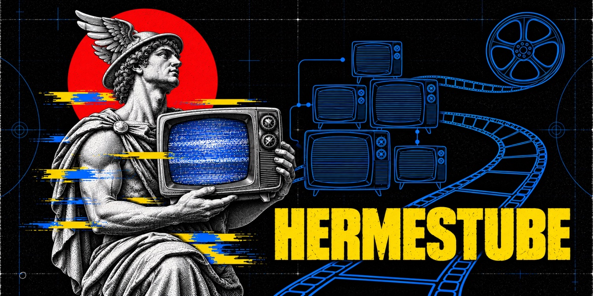

<table>
<tr>
<td width="50%" valign="top">
<h3>Organized your way</h3>
Folders, tags and your own tabs. See at a glance what's new from the channels you care about.
</td>
<td width="50%" valign="top">
<h3>Your model does the boring part</h3>
It suggests folders and builds a whole tab from a topic you type.
</td>
</tr>
<tr>
<td width="50%" valign="top">
<h3>Your data stays on your machine</h3>
No sign-up and no server on our side: we collect nothing.
</td>
<td width="50%" valign="top">
<h3>Never without your click</h3>
A small browser extension hooks up your YouTube account. It never unsubscribes from anything unless you click.
</td>
</tr>
</table>

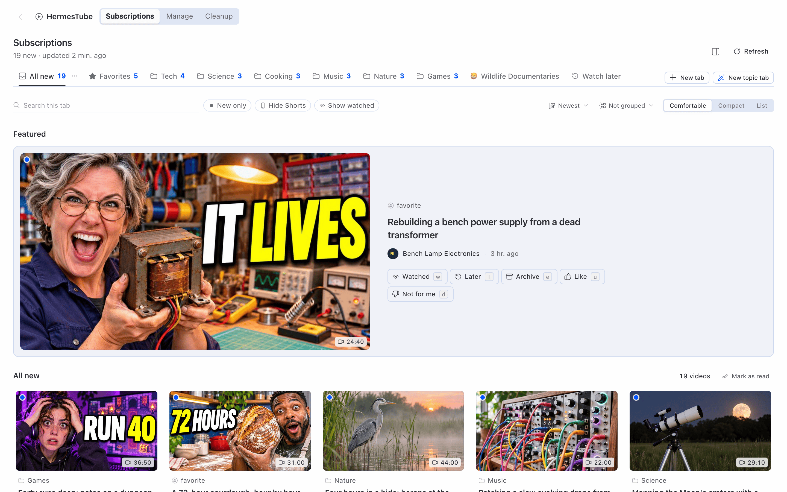

<p align="center"><sub>All screenshots use sample data invented for this project: made-up channels and videos, no real account.</sub></p>

## About

| HermesTube does | HermesTube does not |
|---|---|
| Add a page to Hermes Desktop, tools for the agent, a `/tube` command and optional routines | Unsubscribe on its own: the AI, the tools and the routines only build lists |
| Touch your YouTube account only through a Chrome extension that you load | Use a cloud, an account, an API key of its own or telemetry |
| Work in English and Brazilian Portuguese | Download videos |
| Help most if you already use Hermes with a model set up | Come from the Chrome Web Store yet: the plugin ships the extension |

> [!WARNING]
> HermesTube does not use the official YouTube API. YouTube's Terms of Service may not allow this kind of automated access: use it at your own risk.

> [!NOTE]
> **Experimental:** Cleanup, Telegram, the routines, the chat video cards and the youtube.com bar ran end to end on one real account only. [What ran](#features)

## Features

<table>
<tr>
<td width="56%" valign="middle" align="center">
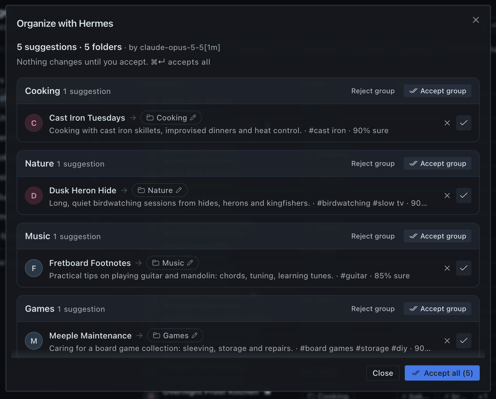
</td>
<td width="44%" valign="middle">
<h3>Organize with Hermes</h3>
<p>Your model proposes folders and tags for your channels. Nothing changes until you accept.</p>
<kbd>Desktop</kbd> <kbd>AI</kbd>
</td>
</tr>
<tr>
<td width="44%" valign="middle">
<h3>Topic tabs</h3>
<p>Type a topic. The model searches YouTube, keeps what fits and says why each video is there.</p>
<kbd>Desktop</kbd> <kbd>AI</kbd>
</td>
<td width="56%" valign="middle" align="center">

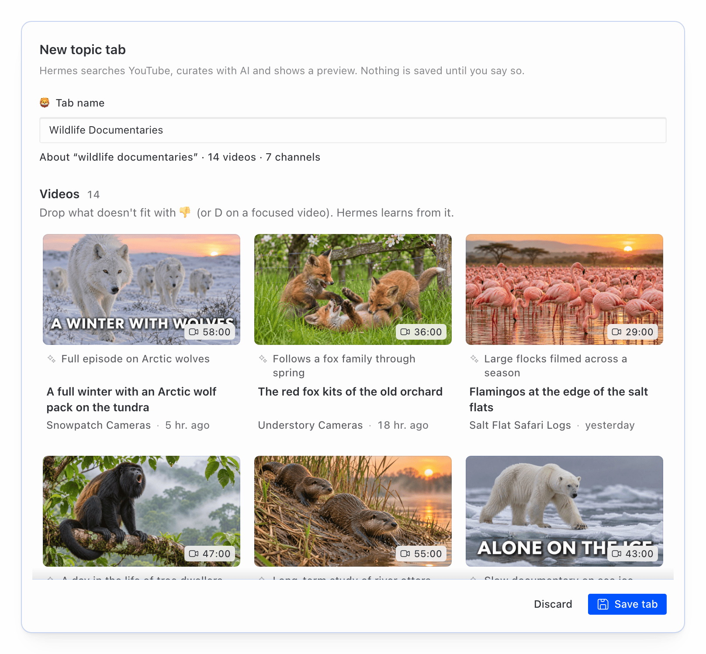

</td>
</tr>
<tr>
<td width="56%" valign="middle" align="center">
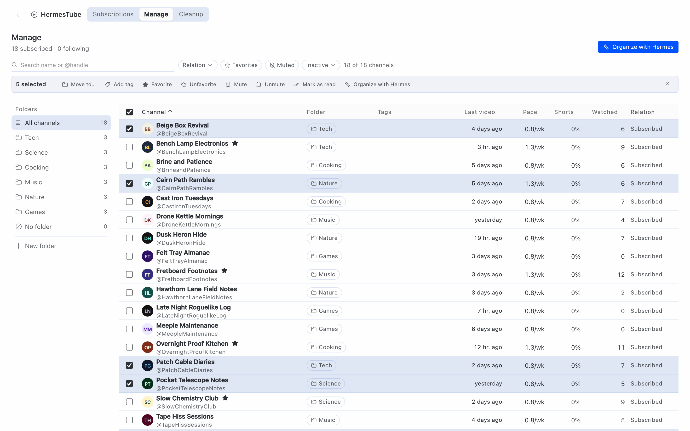
</td>
<td width="44%" valign="middle">
<h3>Manage, with undo</h3>
<p>Every channel in one table, with batch actions. Each change has an Undo, and there is a History and a backup.</p>
<kbd>Desktop</kbd>
</td>
</tr>
<tr>
<td width="44%" valign="middle">
<h3>Watch and playlists</h3>
<p>Videos play inside Hermes. Playlists live on your computer, not on your YouTube account.</p>
<kbd>Desktop</kbd>
</td>
<td width="56%" valign="middle" align="center">
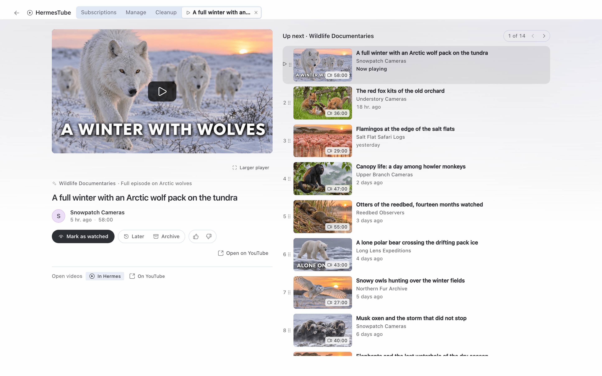
</td>
</tr>
<tr>
<td width="56%" valign="middle" align="center">
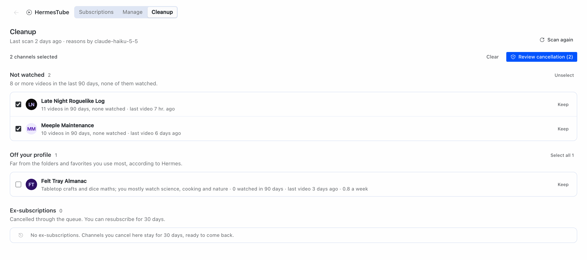
</td>
<td width="44%" valign="middle">
<h3>Cleanup, only with your click</h3>
<p>Fixed rules list inactive channels; the model explains why. Nothing is unsubscribed until you approve and click Run now.</p>
<kbd>Desktop</kbd> <kbd>AI</kbd> <kbd>Extension</kbd>
</td>
</tr>
<tr>
<td width="44%" valign="middle">
<h3>Your folders, everywhere</h3>
<p>A folder pane in Hermes Desktop and a HermesTube bar on youtube.com. Organize from the bar too, with Undo.</p>
<kbd>Desktop</kbd> <kbd>Extension</kbd> <kbd>New in 0.2.0</kbd>
</td>
<td width="56%" valign="middle" align="center">
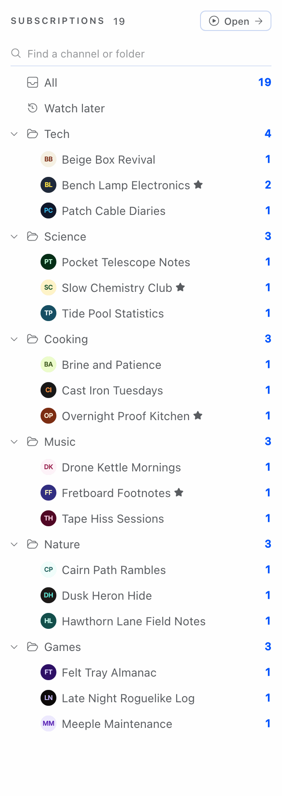
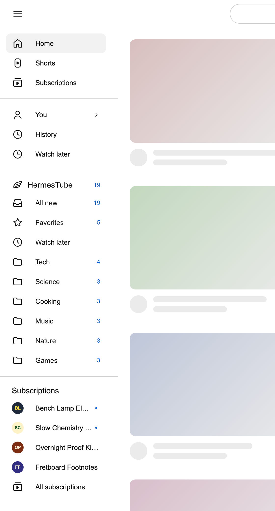
</td>
</tr>
<tr>
<td width="56%" valign="middle" align="center">
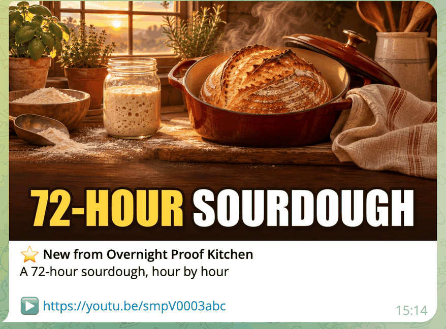
</td>
<td width="44%" valign="middle">
<h3>Telegram and routines</h3>
<p><code>/tube</code> with buttons and five scheduled routines. A favorite channel's new video arrives with cover, title and link.</p>
<kbd>Telegram</kbd>
</td>
</tr>
</table>

<details>
<summary><b>Full feature list, more screens and what has been tested</b></summary>

**More screens**

<table>
<tr>
<td width="50%" valign="middle" align="center">
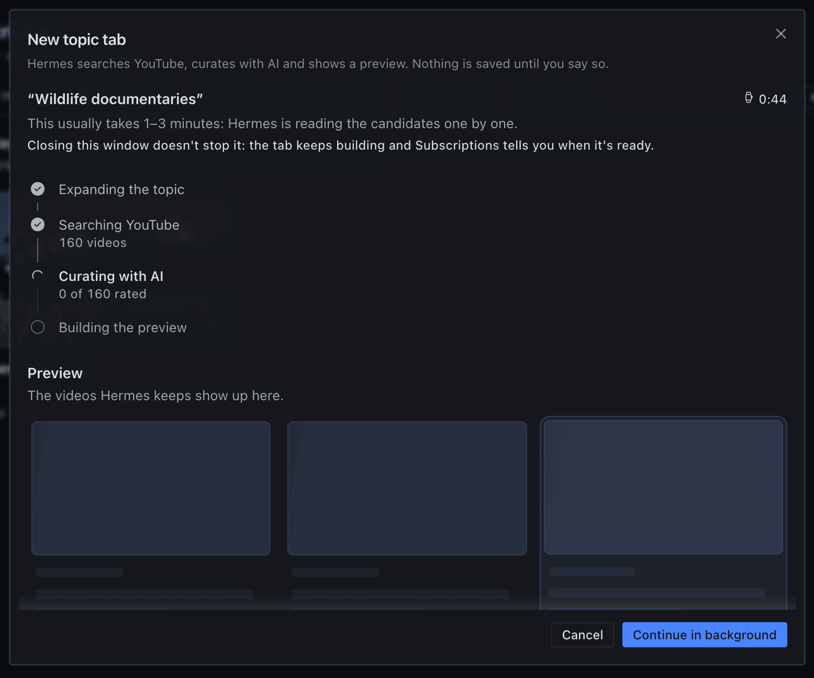
</td>
<td width="50%" valign="middle" align="center">
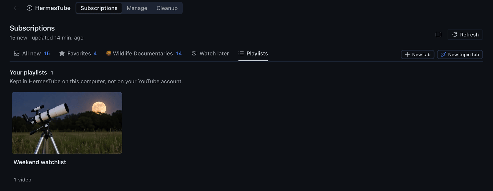
</td>
</tr>
</table>

**Every feature**

- A Subscriptions section with built-in tabs (All new, Favorites, Watch later) and tabs you make: Category (folders and tags), Channels, Topic or Mixed.
- Per-tab filters: hide Shorts, unwatched only, videos per channel, duration.
- A line on every video saying why it is in the tab (folder, tag, channel or topic).
- Mark as watched, save for later, archive, "not for me".
- Folder pane with nested folders and new-video counts, a status bar counter and command palette entries.
- Favorite folders as well as favorite channels, and an Only favorites view in the folder pane and in the bar on youtube.com.
- Manage table (folder, tags, last video, pace, share of Shorts, recent watching, relation) with batch actions. Each change shows an Undo button for a few seconds.
- History of the changes to channels and folders, with Undo, and a backup you export and import (More actions in Manage).
- Follow a channel without subscribing: paste a channel link, a video link or an @handle.
- Organize with Hermes: folder and tag suggestions from your Hermes model, accepted or rejected by group.
- Cleanup with approval (inactive, not watched, off your profile, marked by you) and Ex-subscriptions with Resubscribe for 30 days.
- Topic tabs built from YouTube search results by your Hermes model.
- Videos play in the Watch section with Hermes's own embedded player, under the app's embed consent.
- Playlists: Add to playlist on any video card or in the player, and a Playlists tab with Play all, rename and delete. They are kept in the plugin's database; nothing is written to your YouTube account.
- Nine agent tools, video cards in the Desktop chat, and `/tube` with buttons on Telegram.
- Five scheduled routines on Hermes's own scheduler; four of them use no model.
- Demo data: 40 public channels in 6 folders, without touching your account.
- Companion Chrome extension: subscription sync, watch history, a bar on youtube.com and the approved unsubscribes.
- The bar on youtube.com goes in YouTube's menu, docks on the right or stays hidden, collapses, and opens with a keyboard shortcut. You choose its place in the bar, in the extension's popup or in Hermes, under In the browser.
- Edit mode in the bar: reorder folders, move channels and mark favorites, with Undo.
- A card on channel pages to follow the channel in HermesTube, mark it as a favorite or put it in a folder; on video pages, also Watch later and Add to playlist.
- Hermes warns when a connected browser still runs an older copy of the extension.
- English and Brazilian Portuguese for `/tube`, the routines, the extension and the names the AI writes. The Desktop pages follow the app and are in English today.

**What has been run end to end**

- **In real Chrome on macOS, on one signed-in YouTube account with the interface in Brazilian Portuguese and one to three subscriptions:** reading subscriptions, unsubscribing and resubscribing through the extension, and, for 0.2.0, the bar in its three places, collapsing it, its keyboard shortcut, Edit mode with reordering and Undo, favorites and Only favorites, the channel card (follow, favorite, move, new folder), History with the undo of a change made in the browser, and Export backup.
- **On one real Telegram chat:** `/tube` status and tabs, triage with its buttons, cleanup with an empty list, installing the routines, and the morning digest message.
- **Not yet run in a real app:** Import backup, drag and drop in the bar, typing a folder name with an input method editor (IME), and Windows.
- **Built and covered by automated tests but not yet run end to end either:** the other four routines' messages, `/tube topic` on Telegram, the video cards in the Desktop chat, adding a channel by link, other YouTube interface languages and long subscription lists.
- Treat all of them as experimental.

</details>

## Installation

| You need | |
|---|---|
| **Hermes Agent 0.23.1** or newer | with Hermes Desktop |
| **A model** set up in Hermes | only for the AI features |
| **A Chromium browser** signed in to YouTube | Chrome 120 or newer, Edge, Brave, Vivaldi, Opera, Arc |
| **macOS or Linux** | Windows: looking for testers |
| **git** | the install clones the repository |

> [!IMPORTANT]
> Install HermesTube in the Hermes on the computer where your browser is: the extension only talks to the Hermes on its own computer.

1. **Install the plugin.**

   ```bash
   hermes plugins install pedroberaldo87/hermes-tube/plugin --enable
   ```

   Hermes warns that this is a "custom (unreviewed) source": expected for a plugin installed from a repository.

2. **Open HermesTube** in the Hermes Desktop sidebar. Load the demo, paste a channel, or connect the extension.

3. **Set up the extension.** Press **Set up the extension**, then turn on Developer mode in your browser and drag the folder onto its Extensions page.

4. **Pair it.** Type the 6-digit code from Hermes into the tab the extension opens, and press Connect.

<p align="center">
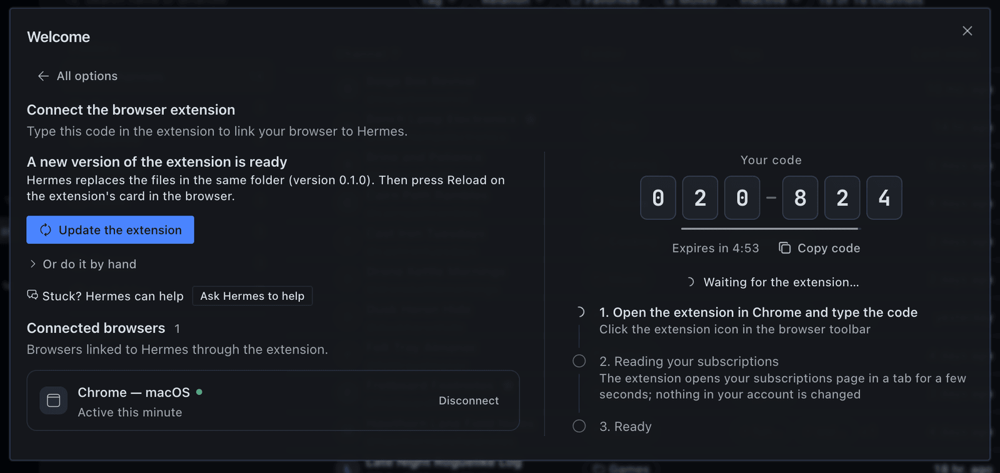
</p>

- The full guide, with troubleshooting and how to remove everything, is in [docs/user/install.md](docs/user/install.md).
- To remove the plugin: `hermes plugins remove hermes-tube` (remove the routines first if you installed them).

<details>
<summary><b>Troubleshooting, requirements in detail and building the extension yourself</b></summary>

**The steps in full**

- If your Hermes Desktop is connected to a gateway on another computer, switch it to This device before you open HermesTube.
- Set up the browser extension: in HermesTube choose "Connect the browser extension", pick your browser if Hermes found more than one, and press **Set up the extension**.
- The plugin ships the extension built; Hermes copies it to a `HermesTube Extension` folder in your home folder and opens that browser's Extensions page and the folder.
- The browser then needs two clicks from you: turn on Developer mode, and drag the folder onto the page (or choose Load unpacked and pick it).
- The screen always shows these steps, the address and the folder path with copy buttons, so you can also do it by hand; if you get stuck, **Ask Hermes to help** opens a chat with a ready request that you read and send.
- Later, the same button updates the extension.
- If you are updating from 0.1, restart Hermes once ([how to update](docs/user/install.md#updating)).
- Pair it: on the same screen a 6-digit code appears (valid for 5 minutes, single use).
- Type it in the tab the extension opens when it is loaded (or in its popup) and press Connect.

**If something does not show up**

- Once the catalog listing is live, `hermes plugins install hermes-tube` works too on macOS and Linux (until then it says the plugin is not in the catalog).
- Without `--enable`, answer yes to "Enable now?", or switch the plugin on in Hermes Desktop under Capabilities → Plugins.
- If HermesTube does not show up in the Desktop sidebar, open Capabilities → Plugins and turn on the Desktop switch of the HermesTube row.
- If the tools or `/tube` do not show up, restart the gateway: `hermes gateway restart`.
- If it goes wrong: "The plugin isn't on in …" (in the side panel or on the main screen), or a connect dialog that says you're connected to another computer, means the Desktop is on a profile or a gateway without the plugin.
- Switch the Desktop to This device, go back to the profile where you installed it, or turn the plugin on in Capabilities → Plugins.

**Requirements in detail**

- Hermes Agent 0.23.1 or newer, with Hermes Desktop for the pages.
  - `hermes --version` shows yours; the [Hermes docs](https://hermes-agent.nousresearch.com/docs) say how to install or update it.
- An AI model set up in Hermes for the AI features (organize, cleanup reasons, topic tabs, the folder summary routine).
  - Everything else works without one.
- For the extension: a Chromium browser on the same computer as Hermes, signed in to YouTube — Chrome 120 or newer, Edge, Brave, Chromium, Vivaldi, Opera or (on macOS) Arc.
  - Day-to-day testing is in Chrome on macOS; the install guide says what has been tried on each system.
- Systems: macOS (day to day) and Linux (run in a Debian container, also without a screen).
  - Windows, with Hermes inside WSL 2 (the usual way) or installed natively, is checked only by automated tests and a Linux container that imitates WSL: it has not yet run on a real Windows machine.
  - We are looking for Windows testers: if you run it on Windows, open an issue with what worked and what broke.
  - Pull requests are welcome.
  - The install guide has the details, including what to do when the browser on Windows cannot reach Hermes inside WSL.
- git (the install clones the repository).
  - On a minimal Linux, the Hermes installer also needs `libatomic1`.
  - Node.js 22 or newer only if you build the extension yourself.

**Build the extension yourself**

```bash
git clone https://github.com/pedroberaldo87/hermes-tube
cd hermes-tube
npm ci
EXT_DIST_DIR=extension/dist npm run build:ext
```

- In your browser, open its Extensions page (`chrome://extensions`, `edge://extensions`, …), turn on Developer mode, choose Load unpacked and pick the `extension/dist` folder.

</details>

## Configuration

- Settings live in Hermes, per profile: Capabilities → Plugins, gear on the HermesTube row.
- They are declared in `plugin/plugin.yaml`.

<details>
<summary><b>The five settings and their defaults</b></summary>

| Setting | Default | What it does |
|---|---|---|
| RSS refresh interval (minutes) | 30 | minimum time between automatic checks for new videos (5 or more) |
| Language | `auto` | `en`, `pt-BR` or `auto`; `auto` follows the app on the pages and Hermes's display language (`display.language`) in `/tube`, tools and routines, falling back to English |
| Keep ex-subscriptions (days) | 30 | how long cancelled channels stay in Ex-subscriptions |
| Topic tabs refresh (days) | 7 | saved with each new topic tab; this version does not refresh topic tabs on its own |
| Mascot announces favorites | on | the mascot shows a short note when a favorite channel posts a new video |

- The AI features run on the plugin's own task, listed in Settings → Models as "YouTube curator", so you can give them a different model from the chat.
- The plugin needs no API key and no environment variable.

</details>

## Usage

| Where | Try this |
|---|---|
| **Hermes Desktop** | Open HermesTube in the sidebar. Click a video to watch it; ⌘/Ctrl-click opens it on YouTube. |
| **Chat** | "What's new on YouTube today?" · "Make a tab about home espresso" |
| **Telegram** | `/tube` · `/tube triage` · `/tube cleanup` · `/tube topic <subject>` · `/tube routines` |
| **youtube.com** | Your folders in a HermesTube bar, and a card on channel pages to follow, favorite or file a channel |

**Guides:** [install](docs/user/install.md) · [Telegram](docs/user/telegram.md)

<details>
<summary><b>Usage, in full</b></summary>

**Desktop**

- HermesTube in the sidebar opens the HermesTube page at its Subscriptions section.
- Manage and Cleanup are sections of the same HermesTube page, and the Subscriptions pane shows your folder tree.
- Click a video to watch it in the Watch section, or ⌘/Ctrl-click to open it on YouTube.

**Chat**

- Ask "what's new on YouTube today?", "why don't I see channel X anymore?" or "make a tab about home espresso".
- Hermes uses the plugin's nine `tube_*` tools.
- They never approve a cancellation.

**`/tube`**

- A summary in any chat.
- On Telegram (or another Hermes messaging platform with buttons): `/tube triage`, `/tube cleanup`, `/tube topic <subject>`, `/tube routines`.
- Use it in a direct chat with your bot, not in a group.
- See [docs/user/telegram.md](docs/user/telegram.md).

**Routines**

- Five scheduled routines (morning digest, favorites, folder summary, monthly cleanup list, new channels without a folder), installed from Telegram with one confirmation.
- On Telegram, each new favorite video arrives as one message with the video's cover, the channel, the title and the link (tested on Telegram; other platforms keep the plain cron delivery).
- Routines never mention demo channels.

**Extension**

- Syncs your subscriptions on pairing, every 6 hours and on Sync now; records the videos you watch; adds a HermesTube bar to YouTube, where you can also organize your folders and channels; runs the unsubscribes you approved, one at a time, in a visible tab, with a Stop button.

</details>

## Privacy and disclosure

| | In short |
|---|---|
| **Your library** | One SQLite database in your Hermes profile |
| **What the plugin reads** | Public `www.youtube.com` pages, without login |
| **What the AI features send** | Channel names, video titles and your folder names, to the model you set up in Hermes |
| **The extension** | Talks only to the plugin on `127.0.0.1` and acts only in your signed-in browser |
| **Telemetry** | None: no analytics, no server of ours |

- Everything the plugin does on your machine and on the network, with the file that shows it, is in the [Disclosure section of plugin/README.md](plugin/README.md#disclosure).

<details>
<summary><b>The full list</b></summary>

- The plugin reads only public `www.youtube.com` pages (and, for the favorites cover, `i.ytimg.com` images), without login: channel RSS feeds, channel pages, the uploads and Shorts playlists of each channel, `/shorts/<id>` and `/watch` pages to learn each recent video's length and whether it is a Short, and the search page for topic tabs.
  - The Desktop pages load thumbnails from `i.ytimg.com` and channel avatars from the addresses YouTube gives.
- Your data is one SQLite database in the Hermes profile (`<HERMES_HOME>/plugin-data/hermes-tube/`).
  - The AI features send channel names, video titles and your folder names to the model you set up in Hermes, also from scheduled jobs made from the plugin's automation blueprints, which run with nobody present.
- The extension talks only to the plugin's local server on `127.0.0.1` (ports 47615 to 47624) and acts only in your signed-in browser.
- No telemetry, no analytics, no server of ours.

</details>

## How it works

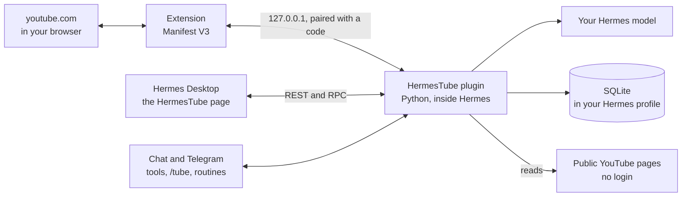

<details>
<summary><b>The parts, and the files behind each one</b></summary>

**Plugin** (`plugin/`, Python, runs inside Hermes)

- REST routes for the Desktop pages (`plugin/dashboard/plugin_api.py`, `plugin/api/`), RPC methods for long jobs and approvals (`plugin/rpc/`), agent tools (`plugin/tools/`), the `/tube` command (`plugin/commands.py`), routines and blueprints (`plugin/routines/`, `plugin/blueprints.py`) and a `pre_llm_call` hook for the chat video card.
- Data goes to SQLite through Hermes's plugin storage (`plugin/adapters/storage.py`)
- YouTube pages are read with the standard library (`plugin/core/youtube.py`, `plugin/core/http.py`)
- model calls go through Hermes (`plugin/adapters/hermes_llm.py`).

**Desktop pages** (`desktop-src/`, TypeScript and React on the Hermes Desktop plugin SDK)

- built with esbuild, not minified, into `plugin/desktop/plugin.js`, which Hermes Desktop loads.

**Extension** (`extension/`, Manifest V3, Preact, built with Vite)

- reads youtube.com in your browser and talks to a small HTTP server the plugin starts on demand on `127.0.0.1` (`plugin/ext/_server.py`), after pairing with a code.

**Shared contract**

- the REST API (`contract/api.yaml`), the database schema (`contract/schema.sql`), the extension protocol (`contract/ext-protocol.md`) and the types generated from them (`shared/`).

- The Hermes plugin catalog installs only the `plugin/` folder.
- It carries a built copy of the extension (`plugin/extension/`, rebuilt with `npm run build:ext:plugin`), which the "Set up the extension" button copies out; the extension's source is `extension/`.

</details>

## Development

- You need a local checkout of Hermes Agent with the `hermes` command on your PATH, [uv](https://docs.astral.sh/uv/), and Node.js 22 or newer.
- Details in [CONTRIBUTING.md](CONTRIBUTING.md).

```bash
make venv              # .venv with Hermes's Python plus pytest and ruff
npm ci
scripts/check          # ruff, pytest, plugin doctor, tsc, vitest, both builds, generated types, catalog validation
scripts/check --fast   # the same without the builds
npm run typecheck      # tsc only
npm run test:js        # vitest only
```

<details>
<summary><b>Environment variables and test notes</b></summary>

- `HERMES_SRC` points to the Hermes Agent checkout (default `$HOME/.hermes/hermes-agent`); `TUBE_PY` overrides the Python that `scripts/check` uses.
- `HERMES_TUBE_DEV_PROFILE=<profile> make link-dev` links `plugin/` into a Hermes profile you use for development and enables it; `make status` lists that profile's plugins. Use a throwaway profile.
- Tests use saved or synthetic pages, not the network. Tests that hit the network are marked `live` and are left out by default.

</details>

## Security

- Please report vulnerabilities privately, as described in [SECURITY.md](SECURITY.md).
- It also lists what the plugin and the extension touch.

## Contributing

- Issues and pull requests are welcome.
- See [CONTRIBUTING.md](CONTRIBUTING.md) and the [Code of Conduct](CODE_OF_CONDUCT.md).

## License

MIT, see [LICENSE](LICENSE). Copyright (c) 2026 Pedro Beraldo.

*Author.* Pedro Beraldo: [GitHub](https://github.com/pedroberaldo87) · [X](https://x.com/PedroBeraldo)

Independent project: not affiliated with or endorsed by YouTube, Google or Nous Research.

<details>
<summary><b>Credits and notices</b></summary>

**Where it comes from**

- HermesTube continues MyTube (github.com/pedroberaldo87/MyTube), a Chrome extension by the same author that organized subscriptions inside youtube.com.
- MyTube was published under GPL-3.0; code carried over from it is relicensed under MIT by its sole author.

**How it was built**

- HermesTube was built with Hermes Agent itself.
- Pedro Beraldo defined the product, wrote down the decisions and decided what ships.
- An AI agent turned that into a plan and more than 80 written task briefs; each brief was run by a separate Hermes Agent session using a Claude model, in its own git worktree, writing tests first.
- Work was merged after review, and the project's full check (tests, type check, catalog validator) gates what ships.

**What belongs to Hermes**

- Hermes Agent and Hermes Desktop are made by Nous Research (MIT).
- HermesTube is built on their plugin interfaces.
- The video player is Hermes Desktop's own embedded player; the plugin only hands it the video link.
- This is an independent project, not affiliated with or endorsed by Nous Research.

**Third-party code**

- The Python plugin and the Desktop code bundle no third-party library: the Desktop code imports only what Hermes Desktop provides at runtime.
- The browser extension, which the plugin also ships built, bundles Preact (MIT).
- See THIRD_PARTY_NOTICES.md.

**YouTube**

- YouTube is a trademark of Google LLC.
- HermesTube is not affiliated with or endorsed by YouTube or Google.
- It reads public YouTube pages and acts only in your own browser.
- The demo lists 40 public YouTube channels by name; they have no connection with this project.

**Hackathon**

- Built for the Hermes Agent Plugin Hackathon (November 2026).

</details>

License texts of third-party code: [THIRD_PARTY_NOTICES.md](THIRD_PARTY_NOTICES.md).
