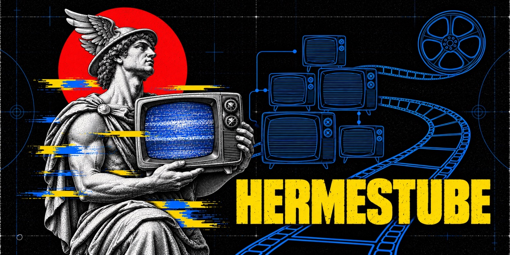
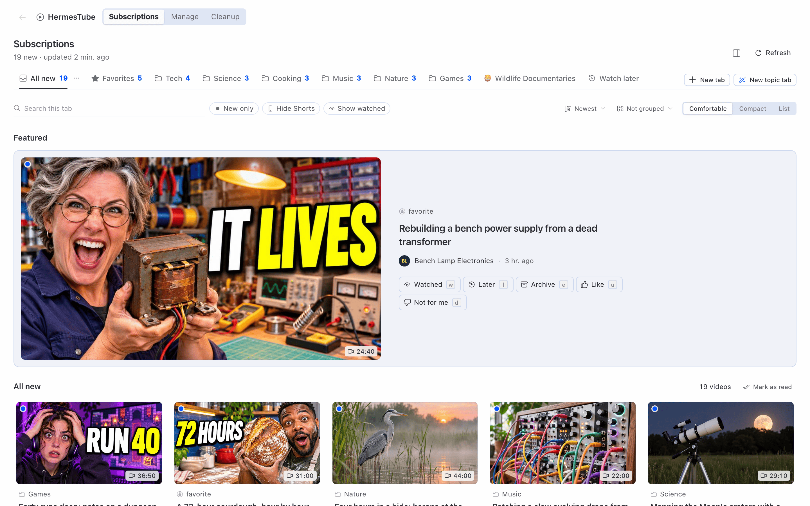
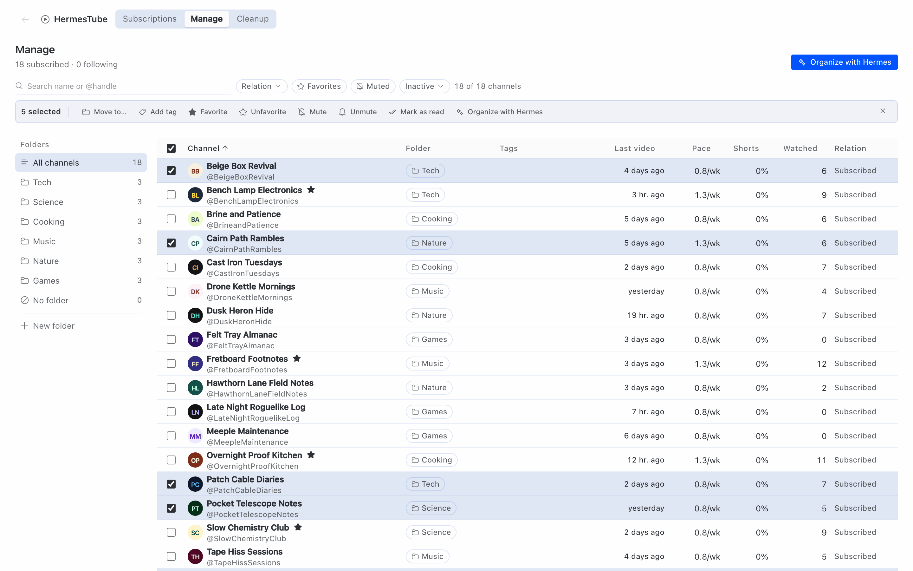
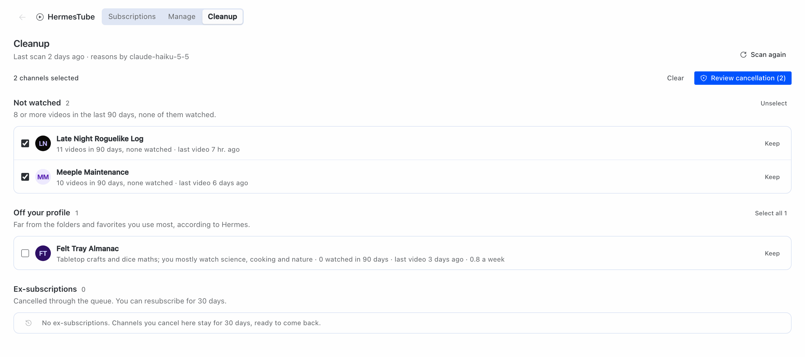
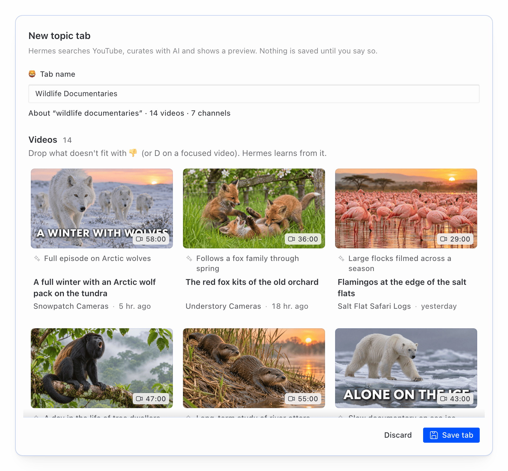
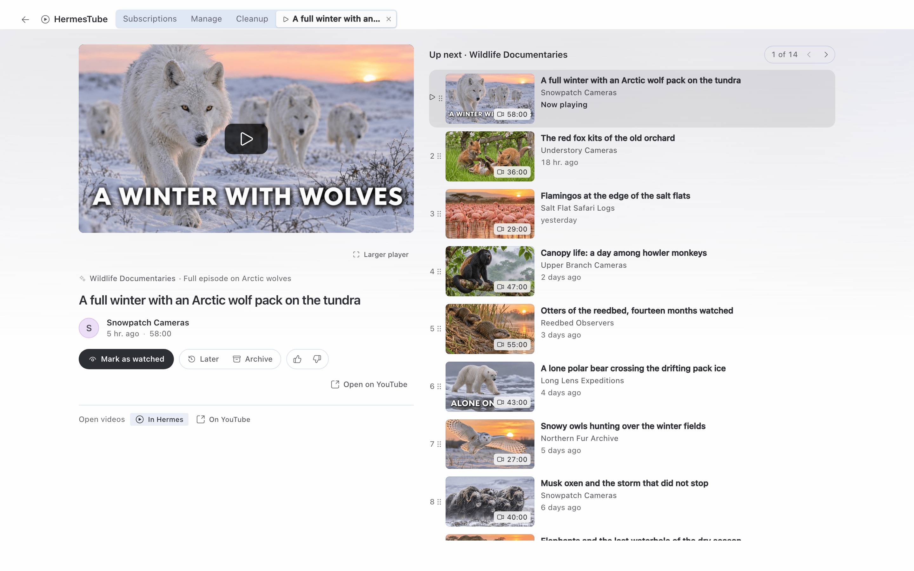
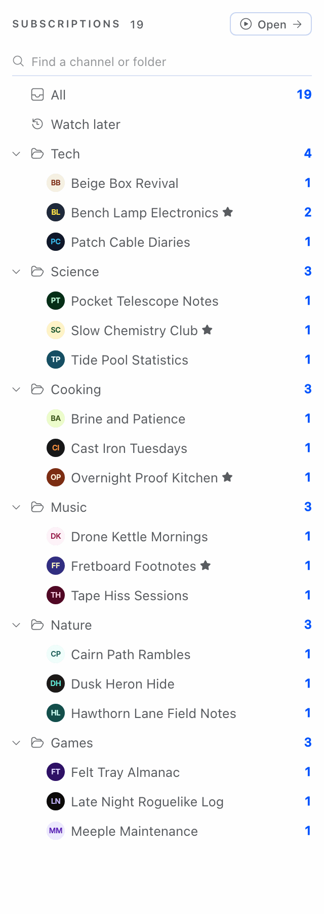
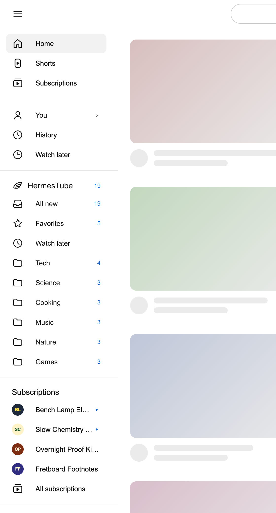

# HermesTube

Retome o controle do que você assiste. O HermesTube traz as suas inscrições do YouTube para dentro do Hermes. Lá você
organiza tudo em pastas e tags, monta as suas próprias abas e vê de relance o que saiu de novo nos canais que
importam. O modelo do seu Hermes faz a parte chata: sugere pastas e monta uma aba inteira a partir de um assunto que
você digita. Não há cadastro nem servidor nosso: não coletamos nada, e os seus dados ficam no seu computador. Uma
pequena extensão de navegador conecta a sua conta do YouTube, e ela nunca cancela inscrição nenhuma sem o seu clique.
Quem escolhe o que você assiste é você. Não o algoritmo.

[English](README.md) · **Português**

[](LICENSE)






Todas as imagens usam dados de exemplo inventados para o projeto: canais e vídeos fictícios, nenhuma conta real. A interface nas imagens está em inglês.

## Sobre

**O que é.** O HermesTube é um plugin do Hermes Agent. Ele acrescenta uma página ao Hermes Desktop, ferramentas que
o agente pode usar, o comando `/tube` e rotinas agendadas opcionais. Uma extensão do Chrome, que vem com o plugin e
que você carrega, é a única peça que mexe na sua conta do YouTube. É um projeto independente, antes chamado MyTube, e
não é feito pelo YouTube, pelo Google nem pela Nous Research, nem tem ligação com eles.

**Para quem.** Para quem segue muitos canais no YouTube e quer vê-los do próprio jeito, e não numa lista única
ordenada pelo YouTube. Ajuda mais quem já usa o Hermes e tem um modelo configurado nele.

**O que faz.**
- Uma seção Subscriptions com abas suas: por pasta e tag, por canais escolhidos, por assunto, ou misturadas. Cada
  vídeo diz por que está na aba.
- Um painel de pastas e uma tabela Manage com ações em lote e desfazer.
- "Organize with Hermes": o seu modelo propõe pastas e tags; você aceita ou recusa por grupo.
- Abas por assunto: você digita um assunto, o modelo planeja buscas no YouTube, fica com o que serve e diz por quê.
- Os vídeos tocam na seção Watch, no player embutido do próprio Hermes, ao lado de uma lista Up next.
- Pergunte ao agente no chat o que saiu hoje no YouTube; ele responde a partir das suas abas.
- Playlists suas: adicione qualquer vídeo a uma playlist pelo cartão ou pelo player, e toque uma delas na aba
  Playlists. Elas ficam no HermesTube, no seu computador, e não na sua conta do YouTube.

**Novidades desta primeira versão, rodadas de ponta a ponta só em pequena escala.** Estão cobertas por testes
automáticos e rodaram numa conta real do YouTube e numa conversa real do Telegram (o que rodou está no fim de
Funcionalidades); trate-as como experimentais até uma versão dizer o contrário.
- Faxina: regras fixas escolhem canais parados e não assistidos, e o modelo explica o porquê. Você aprova no Hermes,
  clica em Run now na extensão, e só então ela cancela a inscrição, um canal por vez, numa aba visível.
  Ex-inscrições guardam um botão Resubscribe por 30 dias.
- `/tube` com botões no Telegram e cinco rotinas no agendador do Hermes.
- Cartões de vídeo no chat do Desktop e uma seção do HermesTube com as suas pastas no menu lateral do youtube.com.

**O que não faz.**
- Não usa a API oficial do YouTube nem faz login no YouTube. O plugin lê páginas públicas; as ações na conta
  acontecem no seu navegador, pela extensão. Os Termos de Serviço do YouTube podem não permitir esse tipo de acesso
  automatizado: use o HermesTube por sua conta e risco.
- Nunca cancela inscrição sozinho. A IA, as ferramentas do agente e as rotinas só montam listas.
- Sem nuvem, sem conta, sem chave de API própria, sem telemetria.
- Não baixa vídeos.
- Só inglês e português do Brasil. A extensão ainda não está na Chrome Web Store: o plugin traz a extensão, e você a
  carrega no Chrome.

## Funcionalidades

- Uma seção Subscriptions com abas prontas (All new, Favorites, Watch later) e abas que você cria: Category (pastas e tags), Channels, Topic ou Mixed.
- Filtros por aba: esconder Shorts, só não vistos, vídeos por canal, duração.
- Uma linha em cada vídeo dizendo por que ele está na aba (pasta, tag, canal ou assunto).
- Marcar como visto, guardar para depois, arquivar, "não é para mim".
- Painel de pastas aninhadas com contagem de vídeos novos, um contador na barra de status e comandos na paleta.
- Tabela Manage (pasta, tags, último vídeo, ritmo, parcela de Shorts, o que você assistiu, relação) com ações em lote e histórico de mudanças com desfazer.
- Seguir um canal sem se inscrever: cole o link de um canal, o link de um vídeo ou um @handle.
- Organizar com o Hermes: sugestões de pasta e tag do seu modelo no Hermes, aceitas ou recusadas por grupo.
- Faxina com aprovação (parados, não assistidos, fora do seu perfil, marcados por você) e Ex-inscrições com Reinscrever por 30 dias.
- Abas por assunto montadas pelo seu modelo no Hermes a partir dos resultados de busca do YouTube.
- Os vídeos tocam na seção Watch, no player embutido do próprio Hermes, com o consentimento de embeds do app.
- Playlists: Add to playlist em qualquer cartão de vídeo ou no player, e uma aba Playlists com Play all, renomear e
  apagar. Ficam no banco do plugin; nada é gravado na sua conta do YouTube.
- Nove ferramentas do agente, cartões de vídeo no chat do Desktop e `/tube` com botões no Telegram.
- Cinco rotinas no agendador do próprio Hermes; quatro delas não usam modelo.
- Dados de demonstração: 40 canais públicos em 6 pastas, sem mexer na sua conta.
- Extensão do Chrome: sincroniza as inscrições, registra o que você assiste, põe uma barra lateral no youtube.com e faz os cancelamentos aprovados.
- Inglês e português do Brasil.

Esta é a primeira versão. Rodaram de ponta a ponta numa conta real do YouTube (interface em português do Brasil, de uma a três inscrições): a leitura das inscrições, o cancelamento e a reinscrição pela extensão e a barra lateral no youtube.com. Rodaram numa conversa real do Telegram: `/tube` status e abas, a triagem com os botões, a faxina com a lista vazia, a instalação das rotinas e a mensagem do resumo da manhã. Feitos e cobertos por testes automáticos, mas ainda sem rodar de ponta a ponta: as mensagens das outras quatro rotinas, o `/tube assunto` no Telegram, os cartões de vídeo no chat do Desktop, adicionar um canal pelo link, outros idiomas da interface do YouTube e listas longas de inscrições. Trate todos como experimentais.

Os nomes das telas e dos botões ficam em inglês aqui porque as imagens e o guia de instalação usam a interface em inglês; com o Hermes em português, o plugin mostra tudo em português.

## Instalação

Instale o HermesTube no Hermes do computador onde está o seu navegador: a extensão só conversa com o Hermes do próprio computador. Se o seu Hermes Desktop está ligado a um gateway de outro computador, troque para This device antes de abrir o HermesTube.

Você precisa de:

- Hermes Agent 0.23.1 ou mais novo, com o Hermes Desktop para as páginas.
- Um modelo de IA configurado no Hermes para os recursos de IA (organizar, motivos da faxina, abas por assunto, a rotina de resumo por pasta). O resto funciona sem modelo.
- Para a extensão: um navegador Chromium no mesmo computador do Hermes, com a conta do YouTube aberta — Chrome 120 ou mais novo, Edge, Brave, Chromium, Vivaldi, Opera ou (no macOS) Arc. O teste do dia a dia é no Chrome, no macOS; o guia de instalação diz o que já foi experimentado em cada sistema.
- Sistemas: macOS (uso diário) e Linux (rodado num contêiner Debian, também sem tela). O Windows, com o Hermes dentro do WSL 2 (o jeito comum) ou instalado direto, só foi conferido por testes automáticos e por um contêiner Linux que imita o WSL: ainda não rodou num Windows de verdade. O Windows está em beta e procuramos quem teste: se você rodar no Windows, abra uma issue dizendo o que funcionou e o que quebrou. Pull requests são bem-vindos. O guia de instalação tem os detalhes, inclusive o que fazer quando o navegador no Windows não alcança o Hermes dentro do WSL.
- git (a instalação clona o repositório). Num Linux mínimo, o instalador do Hermes também precisa do `libatomic1`. Node.js 22 ou mais novo só se você mesmo gerar a extensão.

1. Instale e habilite o plugin:

   ```bash
   hermes plugins install pedroberaldo87/hermes-tube/plugin --enable
   ```

   O Hermes avisa que é uma "custom (unreviewed) source": é o esperado para um plugin instalado de um repositório. Quando a entrada no catálogo estiver no ar, `hermes plugins install hermes-tube` também funciona (até lá ele diz que o plugin não está no catálogo). Sem o `--enable`, responda "sim" ao "Enable now?" ou ligue o plugin no Hermes Desktop em Capabilities → Plugins. Se as ferramentas ou o `/tube` não aparecerem, reinicie o gateway: `hermes gateway restart`.

2. Abra o HermesTube na barra lateral do Hermes Desktop e carregue a demonstração, cole um canal ou conecte a extensão.

3. Configure a extensão do navegador: no HermesTube, escolha "Connect the browser extension", escolha o navegador se o Hermes achar mais de um e aperte **Set up the extension**. O plugin já traz a extensão pronta; o Hermes copia a extensão para uma pasta `HermesTube Extension` na sua pasta pessoal e abre a página de extensões desse navegador e a pasta. Depois o navegador precisa de dois cliques seus: ligar o Developer mode e arrastar a pasta para a página (ou escolher Load unpacked e selecionar a pasta). A tela sempre mostra esses passos, o endereço e o caminho da pasta com botões de copiar, então dá para fazer à mão também; se travar, **Ask Hermes to help** abre uma conversa com um pedido pronto, que você lê e envia. Mais tarde, o mesmo botão atualiza a extensão.

   Para gerar a extensão você mesmo:

   ```bash
   git clone https://github.com/pedroberaldo87/hermes-tube
   cd hermes-tube
   npm ci
   EXT_DIST_DIR=extension/dist npm run build:ext
   ```

   No navegador, abra a página de extensões (`chrome://extensions`, `edge://extensions`, …), ligue o Developer mode, escolha Load unpacked e selecione a pasta `extension/dist`.

4. Faça o pareamento: na mesma tela aparece um código de 6 dígitos (vale 5 minutos e só uma vez). Digite o código na aba que a extensão abre quando é carregada (ou no popup dela) e aperte Connect.

Se der errado: "The plugin isn't on in …" (no painel lateral ou na tela principal), ou um diálogo de conexão dizendo que você está conectado a outro computador, quer dizer que o Desktop está num perfil ou num gateway sem o plugin. Troque o Desktop para This device, volte ao perfil onde instalou, ou ligue o plugin em Capabilities → Plugins.

O guia completo, com solução de problemas e como remover tudo, está em [docs/user/install.md](docs/user/install.md) (em inglês). Para remover o plugin: `hermes plugins remove hermes-tube` (remova antes as rotinas, se tiver instalado).

## Configuração

Os ajustes ficam no Hermes, por perfil: Capabilities → Plugins, engrenagem na linha do HermesTube. Eles estão declarados em `plugin/plugin.yaml`.

| Ajuste | Padrão | O que faz |
|---|---|---|
| RSS refresh interval (minutes) | 30 | tempo mínimo entre as buscas automáticas de vídeos novos (5 ou mais) |
| Language | `auto` | `en`, `pt-BR` ou `auto`; `auto` segue o app nas páginas e o idioma de exibição do Hermes (`display.language`) no `/tube`, nas ferramentas e nas rotinas, com inglês quando não há informação |
| Keep ex-subscriptions (days) | 30 | por quanto tempo os canais cancelados ficam em Ex-inscrições |
| Topic tabs refresh (days) | 7 | gravado em cada aba por assunto nova; esta versão não atualiza as abas por assunto sozinha |

Os recursos de IA rodam numa tarefa própria do plugin, que aparece em Settings → Models como "YouTube curator"; assim dá para usar nela um modelo diferente do chat. O plugin não precisa de chave de API nem de variável de ambiente.

## Uso

- **Desktop.** O HermesTube na barra lateral abre a página do HermesTube na seção Subscriptions. Manage e Cleanup são seções da mesma página do HermesTube, e o painel Subscriptions mostra a sua árvore de pastas. Clique num vídeo para assistir na seção Watch, ou use ⌘/Ctrl-clique para abrir no YouTube.
- **Chat.** Pergunte "o que saiu hoje no YouTube?", "por que não vejo mais o canal X?" ou "monta uma aba sobre café espresso em casa". O Hermes usa as nove ferramentas `tube_*` do plugin. Elas nunca aprovam um cancelamento.
- **`/tube`.** Um resumo em qualquer chat. No Telegram (ou em outra plataforma de mensagens do Hermes com botões): `/tube triage`, `/tube cleanup`, `/tube topic <assunto>`, `/tube routines` (os subcomandos em português, como `/tube faxina`, também funcionam). Use numa conversa direta com o seu bot, não num grupo. Veja [docs/user/telegram.md](docs/user/telegram.md).
- **Rotinas.** Cinco rotinas agendadas (resumo da manhã, favoritos, resumo por pasta, lista mensal da faxina, canais novos sem pasta), instaladas pelo Telegram com uma confirmação.
- **Extensão.** Sincroniza as inscrições no pareamento, a cada 6 horas e no Sync now; registra os vídeos que você assiste; põe uma seção do HermesTube no menu lateral do YouTube; faz os cancelamentos que você aprovou, um por vez, numa aba visível, com um botão Stop.

<table>
<tr>
<td width="50%" valign="top" align="center">

<br><sub>Manage</sub>
</td>
<td width="50%" valign="top" align="center">

<br><sub>Cleanup</sub>
</td>
</tr>
<tr>
<td width="50%" valign="top" align="center">

<br><sub>Prévia da aba por assunto</sub>

</td>
<td width="50%" valign="top" align="center">

<br><sub>Watch</sub>
</td>
</tr>
</table>

<p align="center">


</p>

## Privacidade e divulgação

- O plugin lê só páginas públicas de `www.youtube.com`, sem login: os feeds RSS dos canais, as páginas dos canais, as playlists de envios e de Shorts de cada canal, as páginas `/shorts/<id>` e `/watch` para saber a duração de cada vídeo recente e se ele é um Short, e a página de busca para as abas por assunto. As páginas do Desktop carregam as miniaturas de `i.ytimg.com` e os avatares dos canais dos endereços que o YouTube informa.
- Seus dados ficam num banco SQLite dentro do perfil do Hermes (na pasta `plugin-data/` do perfil). Os recursos de IA mandam nomes de canais, títulos de vídeos e os nomes das suas pastas para o modelo que você configurou no Hermes, inclusive a partir de jobs agendados criados com os blueprints de automação do plugin, que rodam sem ninguém presente.
- A extensão conversa só com o servidor local do plugin em `127.0.0.1` (portas 47615 a 47624) e age só no seu navegador, com a sua sessão.
- Sem telemetria, sem analytics, sem servidor nosso.

Tudo o que o plugin faz no seu computador e na rede, com o arquivo que mostra cada coisa, está na [seção Disclosure do plugin/README.md](plugin/README.md#disclosure) (em inglês).

## Como funciona

- **Plugin** (`plugin/`, Python, roda dentro do Hermes): rotas REST para as páginas do Desktop (`plugin/dashboard/plugin_api.py`, `plugin/api/`), métodos RPC para tarefas longas e aprovações (`plugin/rpc/`), ferramentas do agente (`plugin/tools/`), o comando `/tube` (`plugin/commands.py`), rotinas e blueprints (`plugin/routines/`, `plugin/blueprints.py`) e um hook `pre_llm_call` para o cartão de vídeo no chat. Os dados vão para o SQLite pelo armazenamento de plugins do Hermes (`plugin/adapters/storage.py`); as páginas do YouTube são lidas com a biblioteca padrão (`plugin/core/youtube.py`, `plugin/core/http.py`); as chamadas ao modelo passam pelo Hermes (`plugin/adapters/hermes_llm.py`).
- **Páginas do Desktop** (`desktop-src/`, TypeScript e React sobre o SDK de plugins do Hermes Desktop): geradas com esbuild, sem minificar, em `plugin/desktop/plugin.js`, que o Hermes Desktop carrega.
- **Extensão** (`extension/`, Manifest V3, Preact, gerada com Vite): lê o youtube.com no seu navegador e conversa com um pequeno servidor HTTP que o plugin liga sob demanda em `127.0.0.1` (`plugin/ext/_server.py`), depois do pareamento com um código.
- **Contrato compartilhado**: a API REST (`contract/api.yaml`), o esquema do banco (`contract/schema.sql`), o protocolo da extensão (`contract/ext-protocol.md`) e os tipos gerados a partir deles (`shared/`).

O catálogo de plugins do Hermes instala só a pasta `plugin/`. Ela leva uma cópia pronta da extensão (`plugin/extension/`, gerada de novo com `npm run build:ext:plugin`), que o botão "Set up the extension" copia para fora; o código-fonte da extensão fica em `extension/`.

## Desenvolvimento

Você precisa de um checkout local do Hermes Agent com o comando `hermes` no PATH, do [uv](https://docs.astral.sh/uv/) e do Node.js 22 ou mais novo. Detalhes em [CONTRIBUTING.md](CONTRIBUTING.md) (em inglês).

```bash
make venv              # .venv com o Python do Hermes mais pytest e ruff
npm ci
scripts/check          # ruff, pytest, plugin doctor, tsc, vitest, os dois builds, tipos gerados, validação do catálogo
scripts/check --fast   # o mesmo sem os builds
npm run typecheck      # só o tsc
npm run test:js        # só o vitest
```

- `HERMES_SRC` aponta para o checkout do Hermes Agent (padrão `$HOME/.hermes/hermes-agent`); `TUBE_PY` troca o Python que o `scripts/check` usa.
- `HERMES_TUBE_DEV_PROFILE=<perfil> make link-dev` liga `plugin/` a um perfil do Hermes que você usa para desenvolver e habilita o plugin; `make status` lista os plugins desse perfil. Use um perfil descartável.
- Os testes usam páginas salvas ou sintéticas, não a rede. Os testes que usam a rede levam o marcador `live` e ficam de fora por padrão.

## Segurança

Relate vulnerabilidades em particular, como explica o [SECURITY.md](SECURITY.md) (em inglês). Ele também lista o que o plugin e a extensão tocam.

## Contribuindo

Issues e pull requests são bem-vindos. Veja o [CONTRIBUTING.md](CONTRIBUTING.md) e o [Código de Conduta](CODE_OF_CONDUCT.md) (em inglês).

## Licença

MIT, ver [LICENSE](LICENSE). Copyright (c) 2026 Pedro Beraldo.

*Autor.* Pedro Beraldo: [GitHub](https://github.com/pedroberaldo87) · [X](https://x.com/PedroBeraldo)

*De onde vem.* O HermesTube continua o MyTube (github.com/pedroberaldo87/MyTube), extensão do Chrome do mesmo autor
que organizava as inscrições dentro do youtube.com. O MyTube foi publicado sob GPL-3.0; o código trazido dele é
relicenciado sob MIT pelo seu único autor.

*Como foi feito.* O HermesTube foi feito com o próprio Hermes Agent. Pedro Beraldo definiu o produto, registrou as
decisões e decidiu o que vai a público. Um agente de IA transformou isso num plano e em mais de 80 roteiros de tarefa
escritos; cada roteiro foi executado por uma sessão separada do Hermes Agent com um modelo Claude, num worktree git
próprio, com os testes escritos primeiro. O trabalho entrou depois de revisado, e o check completo do projeto
(testes, checagem de tipos, validador do catálogo) controla o que vai a público.

*O que é do Hermes.* O Hermes Agent e o Hermes Desktop são da Nous Research (MIT). O HermesTube usa as interfaces de
plugin deles. O player de vídeo é o player embutido do próprio Hermes Desktop; o plugin só passa o link do vídeo. É um
projeto independente, sem ligação com a Nous Research nem endosso dela.

*Código de terceiros.* O plugin em Python e o código do Desktop não embutem biblioteca de terceiros: o código do
Desktop importa só o que o Hermes Desktop fornece na hora. A extensão do navegador, que o plugin também traz pronta,
embute o Preact (MIT). Ver THIRD_PARTY_NOTICES.md.

*YouTube.* YouTube é marca registrada da Google LLC. O HermesTube não tem ligação com o YouTube nem com o Google, nem
endosso deles. Ele lê páginas públicas do YouTube e age só no seu próprio navegador. A demonstração lista 40 canais
públicos do YouTube pelo nome; eles não têm relação com este projeto.

*Hackathon.* Feito para o Hermes Agent Plugin Hackathon (novembro de 2026).

Textos de licença do código de terceiros: [THIRD_PARTY_NOTICES.md](THIRD_PARTY_NOTICES.md).
