# HermesTube

**Your subscriptions. Your way.**

Take back your feed: HermesTube brings your subscriptions into Hermes Agent, where you and your agent decide what you watch. Not the algorithm. In Hermes you organize them into folders and tags, build your own tabs, and see at a glance what's new from the channels you care about. Your Hermes model does the boring part: it suggests folders and builds a whole tab from a topic you type. There's no sign-up and no server on our side: we collect nothing, and your data stays on your machine. A small browser extension hooks up your YouTube account, and it never unsubscribes from anything unless you click.

HermesTube is formerly MyTube, a Chrome extension by the same author. It is an independent project, not affiliated with or endorsed by YouTube, Google, Nous Research or Hermès.

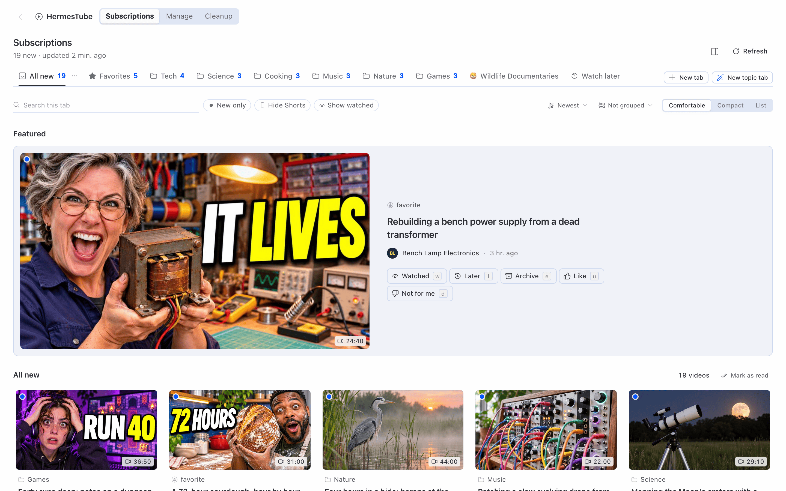

The screenshots use sample data invented for this project: made-up channels and videos, no real account.

## The problem

- YouTube gives you no way to organize your subscriptions your way: no folders, no groups, no priority, no tabs of your own. The Subscriptions page is one long list.
- What you see is ranked by YouTube's recommendation system. A channel you subscribed to can drop out of sight without notice.
- Subscriptions pile up. After a few years you follow hundreds of channels, many of them inactive or never watched, and cleaning up means opening each channel and clicking twice.

## What you can do

**Subscriptions, with your own tabs.** HermesTube in the Hermes Desktop sidebar opens one page; its Subscriptions section has a video grid per tab, and Manage, Cleanup and Watch are sections of the same page. Built-in tabs: All new, Favorites, Watch later. Add your own with New tab: Category (folders and tags), Channels (hand-picked), Topic (see below) or Mixed. Each tab can hide Shorts, show only unwatched videos, cap videos per channel and filter by duration. Every video says why it is in the tab (folder, tag, channel or topic). Mark videos as watched, save for later, archive, or mark "not for me".

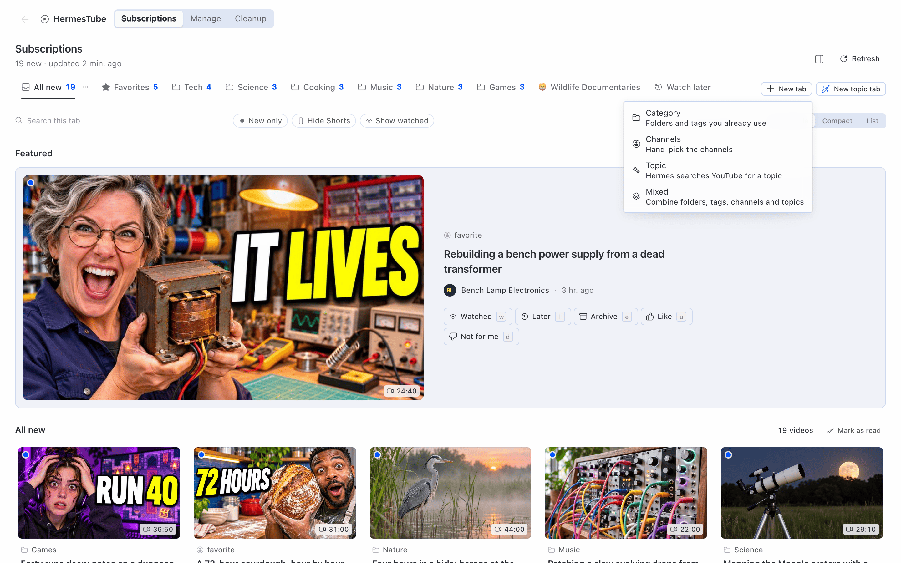

**Playlists.** Choose Add to playlist on any video card (or press `p`) or in the Watch player, and pick or create a playlist. The Playlists tab, right after Watch later, lists them: open one to see its videos, press Play all to queue it in the Watch section, rename it or delete it (the videos stay). Playlists are local: they live in the plugin's database and nothing is written to your YouTube account. The agent can reach them through existing tools: `tube_mark` adds a video to a playlist and `tube_feed` lists the playlists or the videos in one.

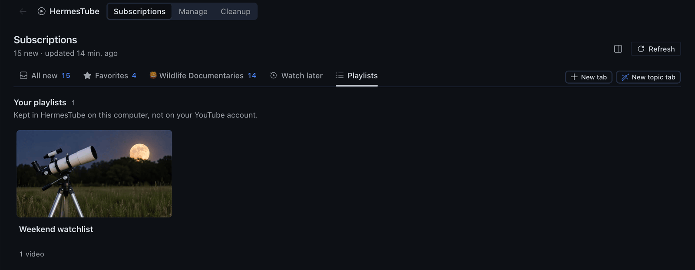

**Folder pane.** A Subscriptions pane in Desktop with your folder tree, channels and new-video counts. Move channels between folders, star favorites, mute, mark as read, open a folder as a tab. A status bar counter shows how many new videos you have, and the command palette has entries for the main actions.

<p align="center">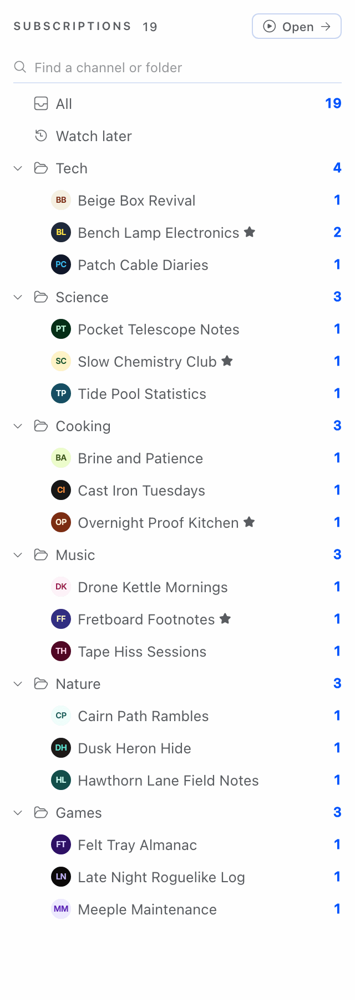</p>

**Manage.** A table of every channel: folder, tags, last video, pace (videos per week), share of Shorts, videos you watched in the last 90 days, and relation (subscribed, following, former subscription). Filter, sort, select many and move, tag, favorite, mute or mark as read in one go. Every change goes to a history with undo.

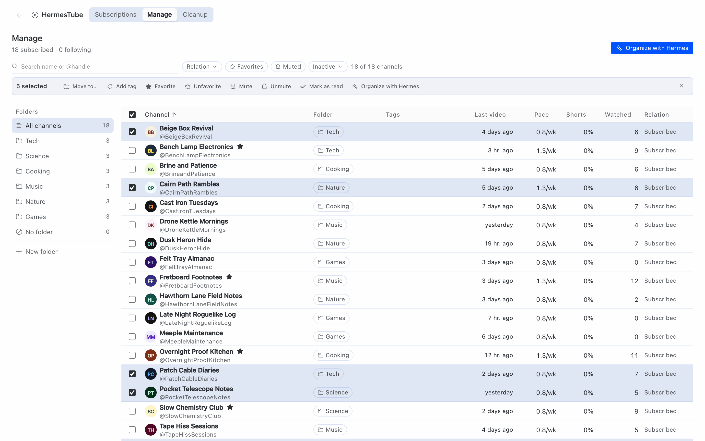

**Follow without subscribing.** Paste a channel link, a video link or an @handle. The channel shows up in your tabs; nothing changes on YouTube.

**Organize with AI.** From Manage, "Organize with Hermes" sends each channel's name, handle and five latest video titles to your Hermes model, which proposes a folder and tags. Suggestions come grouped by folder; accept or reject a group or a single channel. Nothing is applied before you accept, and accepted changes can be undone.

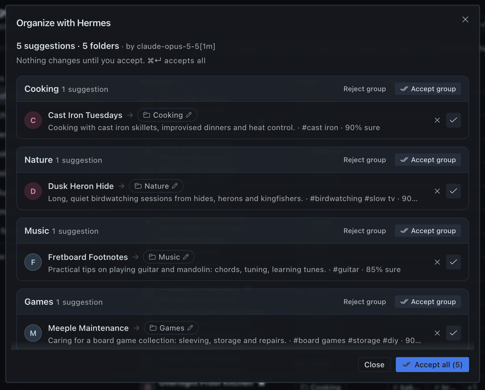

**Cleanup with approval.** The Cleanup section lists channels to drop, in groups:

- Inactive: no new video in 180 days or more.
- Not watched: 8 or more videos in the last 90 days, none watched (needs the watch history from the extension).
- Off your profile: far from the folders and favorites you use most, according to the model.
- Marked by you in Manage.

Nothing is cancelled without a human click. The rules pick the channels; the model only writes the reason and the off-profile group. You tick a group or single channels, press "Review cancellation (N)" and confirm with "Cancel N subscriptions". Only then does the browser extension unsubscribe, one channel at a time, in a visible tab, with a pause between channels and a Stop button. Cancelled channels stay in Ex-subscriptions for 30 days with a Resubscribe button.

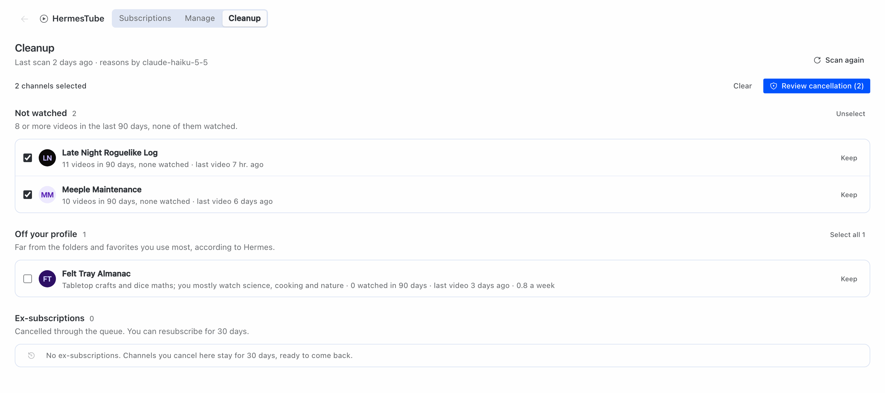

**Topic tabs with AI.** Type a topic ("AI agents for beginners"). The model plans 5 to 8 YouTube searches, the plugin reads YouTube's public search results (best and last month), the model keeps what fits and explains why, and you get a preview with the videos and the channels behind them. Drop what does not fit, then save it as a tab. The same works from the chat ("make a tab about AI agents") and from `/tube topic` on Telegram.

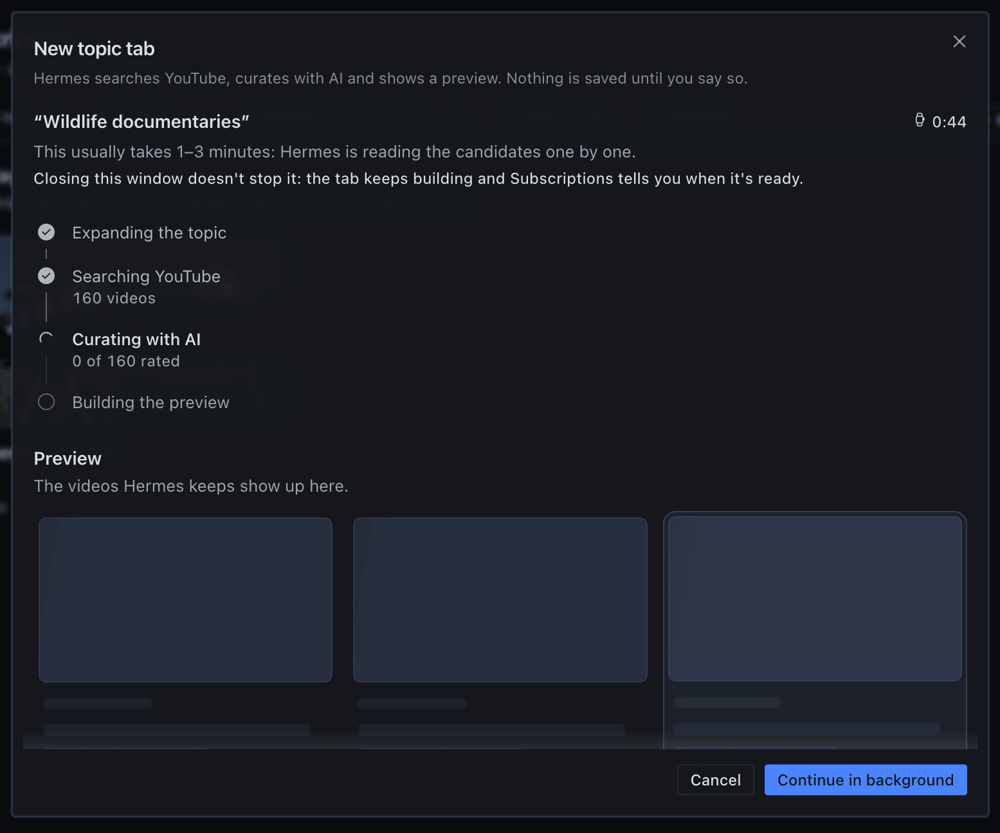

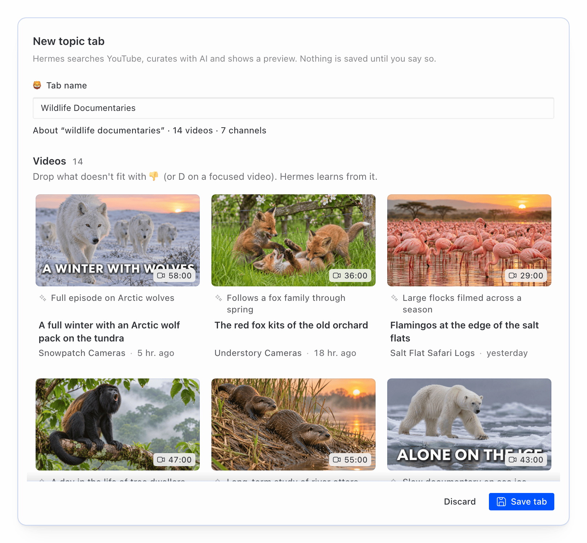

**Watch inside Hermes.** Clicking a video opens it in the Watch section of the HermesTube page, with Hermes's own embedded player (see Disclosure). ⌘-click or Ctrl-click opens YouTube in your browser instead.

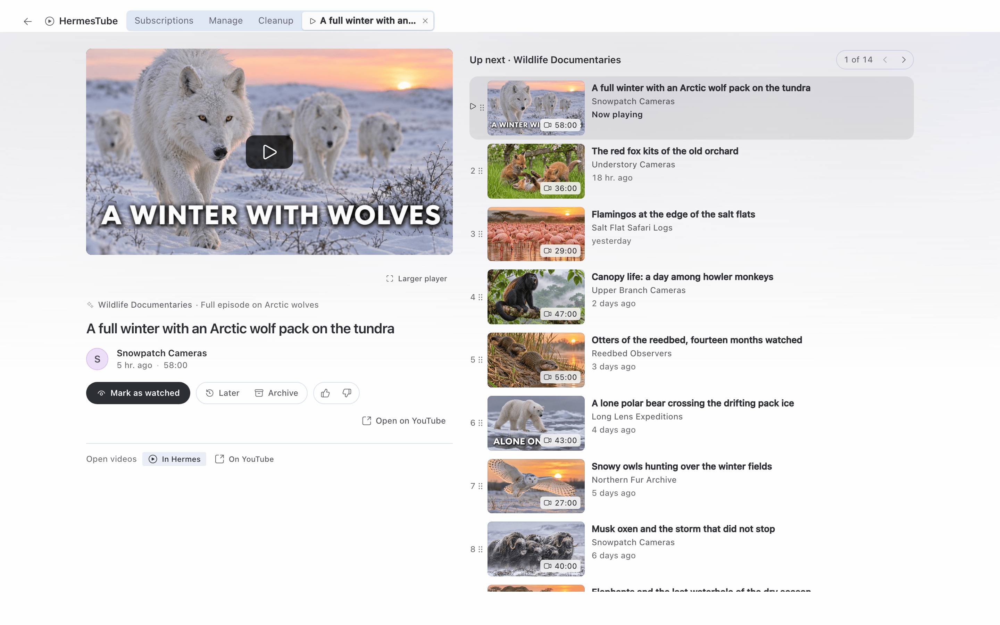

**Ask Hermes.** Nine agent tools (`tube_status`, `tube_feed`, `tube_channels`, `tube_add_channel`, `tube_organize`, `tube_cleanup_scan`, `tube_theme_create`, `tube_tab`, `tube_mark`) let you ask "what's new today?", "why don't I see channel X anymore?" or "make a tab about Y". In the Desktop chat, videos show up as cards with Later and Watched buttons. The tools never approve a cancellation; they build the list and point you to Cleanup or `/tube cleanup`. A skill explains the tools to the agent. It is not loaded by default: ask Hermes to load the skill `hermes-tube:hermes-tube`.

**`/tube` in the chat and on Telegram.** `/tube` gives a summary. On Telegram (or another Hermes messaging platform with buttons): `/tube triage` goes through new videos one by one with buttons, `/tube cleanup` approves cleanup groups in two steps, `/tube topic <subject>` builds and saves a topic tab, `/tube routines` installs the routines. In the Desktop chat and the CLI, `/tube` answers in text and points to the HermesTube page. Use it in a direct chat with your bot (see Disclosure). See [docs/user/telegram.md](../docs/user/telegram.md).

**Scheduled routines.** Five routines run on Hermes's own scheduler:

| Key | When | What it sends |
|---|---|---|
| `bom-dia` | 08:00 daily | new videos from Favorites and counts per tab |
| `favoritos` | every 30 min | only when a favorite channel posts. On Telegram each new video arrives as one message with the video's cover, the channel, the title and the link (tested on Telegram; other platforms keep the plain cron delivery) |
| `resumo-pasta` | 19:00 daily | a short summary of new videos per folder (calls the model only when there is something new) |
| `faxina-mensal` | day 1, 10:00 | the cleanup list and a pointer to `/tube cleanup` (cancels nothing) |
| `pasta-novos` | 09:00 daily | new channels without a folder |

Four are plain scripts that use no model and send nothing when there is nothing new. Separately, Hermes's automation blueprints (Desktop, Cron page) offer three agent versions under the same keys: a folder summary (`resumo-pasta`), the monthly cleanup list (`faxina-mensal`), and folder suggestions for new channels (`pasta-novos`; the model suggests, nothing is applied).


**Sidebar inside youtube.com.** The extension adds a HermesTube section to YouTube's left menu with your folders and tabs, new-video counts, a list of videos per folder and Mark as read.

<p align="center">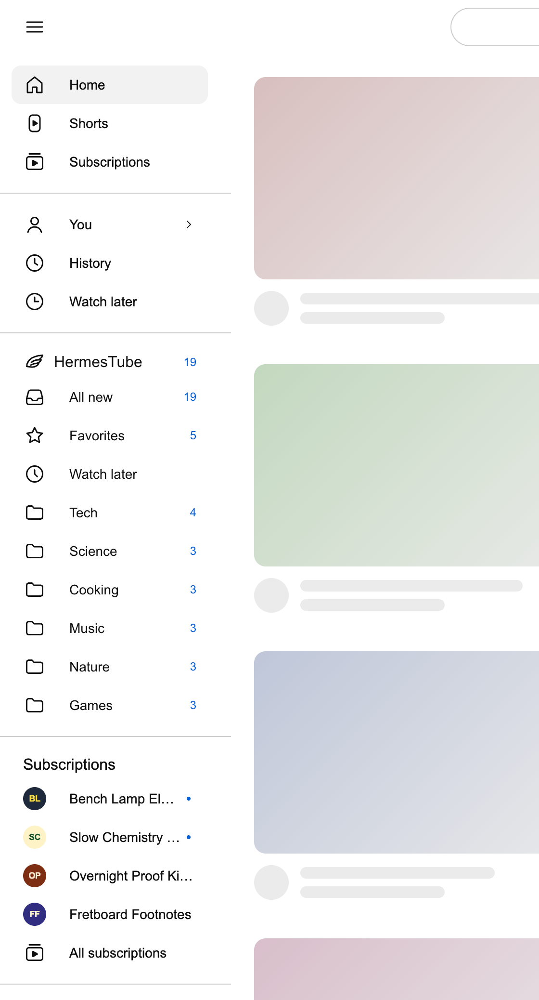</p>

## Install

Install HermesTube in the Hermes on the computer where your browser is: the extension only talks to the Hermes on its own computer. If your Hermes Desktop is connected to a gateway on another computer, switch it to This device before you open HermesTube.

You need:

- Hermes Agent 0.23.1 or newer, with Hermes Desktop for the pages.
- An AI model set up in Hermes for the AI features (organize, cleanup reasons, topic tabs, the folder summary). Everything else works without one.
- A Chromium browser for the extension, signed in to YouTube: Chrome 120 or newer, Edge, Brave, Chromium, Vivaldi, Opera or (on macOS) Arc. Day-to-day testing is in Chrome on macOS; the install guide lists what has been tried on each system.
- Systems: macOS (day to day) and Linux (run in a Debian container, also without a screen). Windows, with Hermes inside WSL 2 or installed natively, is checked only by automated tests and a Linux container that imitates WSL; it has not yet run on a real Windows machine. Windows is in beta and we are looking for testers: if you run it on Windows, open an issue with what worked and what broke. Pull requests are welcome.
- git (the install clones the repository; on a minimal Linux the Hermes installer also needs `libatomic1`). Node.js 22 or newer only if you build the extension yourself (the plugin ships it built).

1. **Install the plugin.**

   ```bash
   hermes plugins install hermes-tube
   ```

   Until the catalog listing is live, that command answers that the plugin is not in the catalog: install from the repository instead, `hermes plugins install pedroberaldo87/hermes-tube/plugin --enable`. Hermes then warns that this is a "custom (unreviewed) source", as it does for any plugin installed from a repository.

2. **Turn it on.** Answer yes to "Enable now?", run `hermes plugins enable hermes-tube`, or switch it on in Hermes Desktop under Capabilities → Plugins (the row has an Agent switch and a Desktop switch; turning the plugin on turns both on). If the tools or `/tube` do not show up, restart the gateway: `hermes gateway restart`.

3. **Set up the browser extension.** The plugin ships the extension already built. In Hermes Desktop, open HermesTube, choose "Connect the browser extension" and pick your browser if Hermes found more than one, and press **Set up the extension**: Hermes copies it to a `HermesTube Extension` folder in your home folder and opens that browser's Extensions page and the folder. No browser lets a program install an extension by itself, so two clicks are yours: turn on Developer mode, then drag the folder onto the page (or choose Load unpacked and pick it). The screen always shows these steps by hand too, with the address and the folder path to copy, and an **Ask Hermes to help** button for when you get stuck. When a plugin update brings a newer extension, the same button says **Update the extension**; then press reload on the extension's card. Hermes and the browser must be on the same computer; with Hermes inside WSL on Windows, the folder goes to your Windows user folder and the Windows browser is used (see the install guide). To build it yourself instead:

   ```bash
   git clone https://github.com/pedroberaldo87/hermes-tube
   cd hermes-tube
   npm ci
   EXT_DIST_DIR=extension/dist npm run build:ext
   ```

   In your browser, open its Extensions page (`chrome://extensions`, `edge://extensions`, …), turn on Developer mode, choose Load unpacked and pick the `extension/dist` folder. Pin the extension to the toolbar.

4. **Pair the extension.** On the same screen, a 6-digit code appears (valid for 5 minutes, single use). Type it in the tab the extension opens when it is first loaded (later, click the extension icon) and press Connect. The extension finds Hermes on this computer by itself. It then opens your YouTube subscriptions page in a tab for a moment and reads the list; nothing in your account changes.

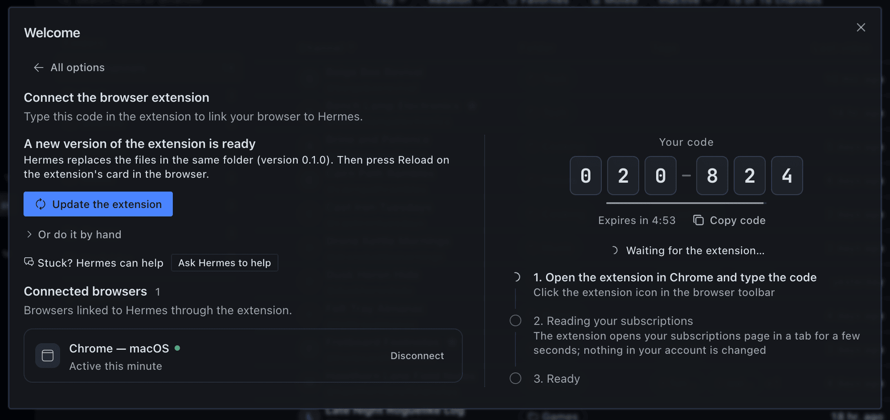

If it goes wrong: "The plugin isn't on in …" (in the side panel or on the main screen), or a connect dialog that says you're connected to another computer, means the Desktop is on a profile or a gateway without the plugin. Switch the Desktop to This device, go back to the profile where you installed it, or turn the plugin on in Capabilities → Plugins.

The step-by-step guide with troubleshooting and removal is in [docs/user/install.md](../docs/user/install.md).

## First run with the demo data

You can try everything except the YouTube account features without the extension.

1. Open HermesTube in Hermes Desktop and choose "Try the demo". It adds 40 real public channels in 6 folders, a few favorites and one topic tab, named in your language (English or Brazilian Portuguese; loading it again in the other language renames only what the demo created). The channels are followed, not subscribed: nothing touches your YouTube account.
2. Videos arrive within seconds from the channels' public feeds.
3. Open the tabs, use the folder pane, mark videos as watched or for later.
4. In Manage, select some channels and choose "Organize with Hermes".
5. In the Subscriptions section, choose New tab → Topic and type a topic.
6. In the chat, ask "what's new on YouTube today?" or type `/tube`.

To remove it, choose "Manage the demo" on the welcome card and clear it. Only what the demo added goes away. Cleanup only looks at real subscriptions, so it stays empty with demo data alone.

## Disclosure

What HermesTube does on your machine and on the network, with the file that shows it.

**Network calls from the plugin (Python).**

- Only `www.youtube.com`, with no login and no account cookie:
  - channel RSS feeds (`/feeds/videos.xml`) for new videos;
  - channel pages (`/@handle`, `/channel/<id>`, `/c/`, `/user/`) to resolve a pasted link, and the channel's `/videos` page when the RSS feed is down;
  - the public search page (`/results`) for topic tabs;
  - each channel's automatic uploads playlist (`/playlist?list=UU…`) and Shorts playlist (`/playlist?list=UUSH…`), to learn the length of recent videos and which ones are Shorts;
  - `/shorts/<id>` (without following the redirect) and the video page `/watch`, for single videos the playlists did not cover.

  See `plugin/core/youtube.py`.
- `i.ytimg.com`, for the cover that the `favoritos` routine attaches to the message of each new video: one `https://i.ytimg.com/vi/<video id>/` JPEG (`maxresdefault.jpg`, then `hq720.jpg`, then `mqdefault.jpg`), tried in turn with a 4 s timeout each and 8 s in total. It is saved as `<HERMES_HOME>/plugin-data/hermes-tube/covers/<video id>.jpg`, the newest 20 files are kept, and any failure just sends the message without a cover. See `plugin/routines/cover.py`.
- Length and Short detection run in the background, without the screen asking: after every refresh, and whenever the Desktop page polls the plugin's status while recent videos (published in the last 30 days, or added in the last 7) still lack that information. One request at a time, 0.75 s apart, at most 40 per pass and 30 s between passes; after a "too many requests" answer it waits 30 minutes. What is learned is stored and not asked again. See `plugin/core/details.py`, `plugin/core/refresh.py`.
- Loading a tab that filters by duration or hides Shorts can also fetch the `/shorts/<id>` and `/watch` pages of the videos on that page that still lack the information. See `plugin/core/feed.py`.
- Requests send a desktop browser User-Agent, `Accept-Language: en-US` and YouTube's anonymous consent cookie `SOCS=CAI`, which goes only to YouTube hosts. At most 4 requests at a time per host, 10 s timeout, 3 attempts. See `plugin/core/http.py`.
- Redirects: the HTTP client follows up to 10 redirects. The consent cookie is sent only to YouTube hosts, and cookie and authorization headers are dropped when a redirect leaves the original host. See `plugin/core/http.py`.
- The HTTP client connects only to public internet addresses. It refuses loopback, private networks, link-local addresses (including cloud metadata at `169.254.169.254`) and other reserved ranges, on every redirect, and checks the address it actually connects to. Responses are capped in size after decompression and in total time. In this version only the YouTube and `i.ytimg.com` URLs above are built. `KNOWN_HOSTS` in `plugin/core/http.py` also lists `hackertube.org` for a hidden Extra that is not implemented (`plugin/core/extras_hn.py` is a stub), so no request goes there.
- When refreshes run: when the Desktop page or the extension asks for status, when you press Refresh, when you add a channel or load the demo, and when an agent tool or a routine needs fresh data, at most once per refresh interval (30 minutes by default). Nothing runs when `register()` loads the plugin. See `plugin/core/refresh.py`, `plugin/api/status.py`.

**What the Desktop pages load.** Video thumbnails straight from `i.ytimg.com` and channel avatars from the address YouTube gives for each channel (in the demo data, `yt3.googleusercontent.com`). Everything else goes to the plugin's own backend inside Hermes. See `desktop-src/components/Thumb.tsx`, `desktop-src/components/ChannelAvatar.tsx`, `plugin/data/demo_channels.json`.

**Watching inside Hermes.** Clicking a video opens the Watch section of the HermesTube page in Hermes Desktop. The player there is Hermes's own embedded YouTube player, the same one Hermes shows for a YouTube link in the chat: it loads the video from `www.youtube-nocookie.com` (in the packaged app, through Hermes's own local embed page), and only under Hermes's embed consent (Settings ▸ Appearance ▸ Inline Embeds: Ask, the default, so nothing reaches YouTube until you press Load; Always; or Off, which leaves a plain link). The plugin draws no player or frame of its own and hands the player only the video link. "Larger player" (off by default) scales the plugin's own box around that player with CSS `zoom`; it does not select or restyle anything inside it. Opening a video does not mark it as watched. ⌘-click or Ctrl-click, and the Open on YouTube button, open the video in your browser instead; to always do that, choose Open videos: On YouTube. If the Watch section is not available, a click opens YouTube. See `desktop-src/lib/player.ts`, `desktop-src/pages/watch/index.tsx`.

**Local server for the extension.**

- A small HTTP server (Python standard library) inside the Hermes process, bound to `127.0.0.1` only, on the first free port from 47615 to 47624. It starts on demand, the first time the Desktop page asks for status, you start pairing, or the `tube_status` tool runs; never in `register()`. It runs in its own thread while it lives, rereads the profile's `config.yaml` every 5 s, and stops when the plugin is disabled there or unloaded. Only one Hermes process per profile runs it, coordinated by a lock file, `ext-server.lock`, in the plugin's data folder. See `plugin/ext/_server.py`, `plugin/wiring.py`.
- It refuses any `Host` header that is not loopback and any `Origin` that is not a `chrome-extension://` origin. Every route except the health check and pairing needs a device token.
- Pairing: a 6-digit code shown in Desktop, valid for 300 s, single use, 5 wrong tries locks it; a new code cancels the old one. The code itself is never sent: pairing is a password-authenticated key exchange (SPAKE2) bound to the port, so another program listening on one of these ports learns nothing it can use, and each try spends one of the code's 5 attempts. Before the extension sends its token to a port, that port must prove it knows the token. The extension gets a random 32-byte token; the database keeps only hashes of codes and tokens. Disconnect in the extension popup revokes the device's token. See `plugin/core/devices.py`, `plugin/ext/_mount.py`.

**Where your data lives.** One SQLite database at `<HERMES_HOME>/plugin-data/hermes-tube/tube.db`, opened through Hermes's `plugin_db` helper for the active profile, plus the server lock file `ext-server.lock` and the routine cover images (`covers/`, the newest 20) in the same folder. The database keeps channels, folders, tags, tabs, playlists, video states, watch history from the extension, the change history and paired devices. It survives `hermes plugins update` and `hermes plugins remove`; delete that folder to erase it. See `plugin/adapters/storage.py`, `contract/schema.sql`.

**Reads outside the plugin's data.**

- The active profile's `config.yaml`, read-only: the plugin's own settings, Hermes's display language (`display.language`, the one the Desktop app uses), whether the plugin is enabled, and whether a model is set up. See `plugin/adapters/settings.py`, `plugin/core/lang.py`, `plugin/adapters/hermes_llm.py`, `plugin/ext/_server.py`. The settings module can also write the plugin's own keys (`plugins.entries.hermes-tube.settings`) through Hermes's config writer, but nothing in this version calls it; the Desktop settings form is Hermes's own.
- The profile's `cron/jobs.json`, read-only, by the `favoritos` routine only: it finds the job it was installed as and reads where that job delivers (the Telegram chat, and the topic if any) to send its message there. Any other shape of that file means no direct delivery. See `plugin/routines/deliver.py`.
- A JSON file you point to: the import routes of the plugin's API (`POST /import/mytube` for a MyTube backup, `POST /import` for a HermesTube export) accept the path of a file on this computer and read it, up to 50 MB, as JSON. The Desktop pages in this version have no button that calls them. See `plugin/api/data.py`.
- The plugin reads no browser profile, cookie store, password, keychain, `.env` or `auth.json`.

**The "Set up the extension" button.** Only when you press it in Desktop (`POST /extension/setup`; no agent tool, routine, `/tube` command or chat reaches it, and nothing runs when the plugin loads), on the computer where Hermes runs:

- it copies the extension shipped inside the plugin to one fixed folder, `HermesTube Extension` in your home folder (with Hermes inside WSL, your Windows user folder), with a marker file `hermes-tube-folder.json` that records that Hermes created the folder, the version and the files it wrote. The route takes no path from the caller, and a home folder that is not an absolute path is refused. If a folder or file with that name exists without that marker, or is a link, Hermes refuses and leaves it as it is. An update rewrites only its own files in place and removes only files the previous marker lists; anything else in the folder stays. On macOS and Linux the folder is opened once without following links and every write goes through that handle, so a folder swapped for a link in the meantime gets nothing written into it. Each time the screen opens, Hermes compares every file it wrote with the bundled copy (SHA-256); a changed or missing file makes the button offer an update, which puts the original back. Uninstalling the plugin does not remove the folder: delete it yourself;
- to know which browsers to offer, it looks for Chrome, Edge, Brave, Chromium, Vivaldi, Opera and (on macOS) Arc in fixed places, reading files only and running nothing: on macOS the app bundles in `/Applications` and in the Applications folder of the home folder (their `Info.plist`); on Linux the usual commands on `PATH`, `/usr/bin`, `/snap/bin` and the Flatpak export folders, plus a Flatpak's own permission files to tell whether it can see the folder; on Windows the usual `.exe` paths under `Program Files`, `Program Files (x86)` and `AppData\Local` (not the registry), also from inside WSL through the mounted Windows drive. Inside WSL it also reads a few files to tell that it is WSL (`/proc/version`, `/etc/wsl.conf`) and lists the folder names in `C:\Users` to find yours. This also happens when the screen opens (`GET /extension/setup`). It never reads a browser profile;
- the request may name one browser, only as a key from that closed list (`chrome`, `edge`, `brave`, `chromium`, `vivaldi`, `opera`, `arc`); a path, a command or any other field is refused before anything is written;
- it opens that browser's own Extensions page (`chrome://extensions/`, `edge://extensions/`…) and shows the folder in the file manager, each with a fixed argument list, never a shell, and a time limit of a few seconds: on macOS `/usr/bin/open -b <bundle id> <address>` and `/usr/bin/open -R <folder>`; on Linux the browser's program (or its snap or Flatpak launcher) with that address and `xdg-open` on the home folder, only when a display is set (`--ozone-platform-hint=auto` is added on a Wayland-only session); on Windows the browser's `.exe` with that address (a `chrome://` address has no file association there) and `explorer.exe /select, <folder>` from the Windows folder (`%SYSTEMROOT%`, never one found in the current folder); with Hermes inside WSL, the same Windows programs through WSL interop, or nothing when interop is off;
- it reports the folder, the version, the browser and what it could open; errors reach the screen as a generic message and the details go to the Hermes log.

The browser still needs your two clicks (Developer mode, then loading the folder), and the extension still needs the pairing code: Hermes never edits browser profiles or settings, never passes `--load-extension` and never clicks for you. If Desktop is connected to Hermes on another computer, all of this happens on that computer. See `plugin/core/extension_setup.py`, `plugin/api/extension.py`.

**"Ask Hermes to help".** Below the setup steps, a second button opens a new chat in Hermes Desktop (the Desktop's public `host.newChat` and `host.composer.setDraft`) with a fixed request written by the plugin, in English: your operating system, the folder path, the chosen browser and its Extensions page, the steps, and rules for the agent (do not read or change the browser's profile or settings, do not get around Developer mode or Load unpacked — no `--load-extension`, no policies, no automated clicks — and do not install anything without telling you first). The request is only a draft: nothing is sent until you read it and press Send, and what the agent then does goes through Hermes's usual tools and approvals. The plugin adds no agent tool for this. On a Desktop without that API the button is "Copy a request for Hermes" and copies the same text. See `desktop-src/dialogs/onboarding/setup-request.ts`.

**What the routines install and how to remove them.** Only after you confirm with a button, `/tube routines` writes small launcher scripts named `hermes-tube-<routine>.py` into `<HERMES_HOME>/scripts/` and creates Hermes cron jobs named `hermes-tube-<routine>` through Hermes's own `cronjob_manage` tool. The scripts run the routine code inside the installed plugin; four are `no_agent` jobs (no model), `resumo-pasta` is an agent job with a pre-check that skips the model when there is nothing new. A maintenance job (`hermes-tube-maintenance`, daily at 04:00, a no-op in this version) is installed with them. The plugin never sets the model of a job. Jobs and scripts are not removed when you uninstall the plugin: run `/tube routines remove` on Telegram first, or remove them with `hermes cron list` and `hermes cron remove <id>` and delete the `hermes-tube-*.py` files from `<HERMES_HOME>/scripts/`. See `plugin/routines/installer.py`, `plugin/routines/catalog.py`, `plugin/commands.py`.

**What the extension does on youtube.com.**

- It runs on `https://www.youtube.com/*` and talks only to the plugin's local server on `127.0.0.1`. Permissions: `storage`, `alarms`, `tabs`, `scripting`; host permissions: `http://127.0.0.1/*` (the local server) and `https://www.youtube.com/*`. See `extension/manifest.json`.
- The `tabs` permission is for the extension's own tab only: it notes which tab you are on, so it can open its YouTube tab next to it and switch back afterwards, and it reads where its own tab ended up (for example Google's sign-in page when you are signed out). Chrome describes this permission as "Read your browsing history"; the extension does not read, keep or send the address or title of any other tab. See `extension/src/background/queue.ts`, `extension/src/background/sync.ts`.
- Sync: opens your subscriptions page (`/feed/channels`) in a tab, scrolls it and sends the list of channels to the plugin; on pairing, every 6 hours and when you press Sync now. Read-only. See `extension/src/content/scraper.ts`, `extension/src/background/sync.ts`.
- Watch history: records a video as watched after more than 60% or 4 minutes of playback and sends the video id, the channel id and the time to the plugin. See `extension/src/content/tracker.ts`, `extension/src/background/history.ts`.
- Sidebar: adds the HermesTube section to YouTube's left menu and loads thumbnails from `i.ytimg.com`. See `extension/src/content/sidebar/`.
- Unsubscribe and resubscribe: only items you approved in Hermes, taken from the plugin's queue. For each one it opens the channel page in a visible tab, checks that the page is that channel, clicks the subscribe button, confirms YouTube's dialog and checks that the button changed. One at a time, with a random 3 to 6 s pause; it stops when you are signed out, when YouTube shows a verification, after 2 failures in a row, or when you press Stop. See `extension/src/background/queue.ts`, `extension/src/content/unsubscribe.ts`.
- It never reads cookies or passwords. It acts in your signed-in browser session the way you would.

**Approval, and its limits.** A cancellation enters the queue only from two places: the "Cancel N subscriptions" button in the confirmation dialog of the Cleanup section in Desktop (opened with "Review cancellation (N)"), which calls the plugin's `cleanup.approve` RPC method, or the confirmation choice of `/tube cleanup` on a messaging platform. There is no REST route that approves, and no agent tool or routine approves. Until the extension runs an item, you can undo it in the Queue of the Cleanup section. See `plugin/core/cleanup.py`, `plugin/rpc/cleanup.py`, `plugin/commands.py`. Known gaps:

- Hermes does not tell a plugin which client made an RPC call. So `cleanup.approve` and `cleanup.resubscribe` accept a call from any client authenticated to your Hermes gateway, not only the Desktop app. So does `pair.start`, which creates a pairing code: such a client could pair itself as a browser, then take approved items before your browser does, or report them as done without running them. Paired browsers are listed under "Connected browsers" when you choose "Connect the browser extension"; disconnect any you do not recognize. See `plugin/rpc/cleanup.py`, `plugin/rpc/pair.py`.
- An agent that can control your screen could press "Cancel N subscriptions" in Desktop.
- Software that runs as your user, including an agent you gave shell or file-write tools in the same profile, can write an approved item straight into the plugin's database (`tube.db`), but it still waits for your click in the extension, as below. Give shell and file tools only to agents you trust in the profile where HermesTube is installed. See `extension/src/background/queue.ts`.
- `/tube` works only in a direct chat with your bot. In a group, channel or thread it approves nothing, installs or removes no routines and shows none of your data: it only answers that it works in a direct chat (`/tube help` also lists the commands). In a direct chat, Hermes's `approvals.approvers` setting still decides who may answer its buttons. On chat apps without buttons, `/tube cleanup` shows numbered options and accepts the typed number or the option's text; approving takes two answers.

- Before each round of unsubscribes, the extension shows the number of approved items on its toolbar icon and asks in its popup ("N approved unsubscribes are waiting"). Nothing changes on YouTube until you click Run now there. The click covers only the items listed at that moment; closing the browser or reloading the extension discards it. An item written straight into the database therefore still waits for your click in the browser.

**Calls to the Hermes model.** Through Hermes's `ctx.llm`, on an auxiliary task the plugin registers ("YouTube curator", selectable in Settings → Models); the plugin holds no API key. Input text passes through Hermes's secret redaction (`agent.redact`) before it is sent. These calls start from a button in Desktop, from `/tube`, or from an agent turn that uses `tube_organize`, `tube_cleanup_scan` or `tube_theme_create`. That includes jobs made from the plugin's automation blueprints: they run on their schedule with nobody present and call those tools, so each run can make these model calls too. The `resumo-pasta` routine and the blueprint jobs are Hermes agent jobs: they run on the profile's main model, or the one you set with `hermes cron edit <id> --model`. See `plugin/blueprints.py`, `plugin/tools/_impl.py`. What goes in the prompt:

- Organize: channel id, name, handle and up to 5 latest video titles, your folder and tag names, and up to 20 of your past corrections.
- Cleanup reasons: channel name, the rule that picked it, days since the last video, videos and watched videos in 90 days, videos per week, recent titles, your folder names and favorite channel names.
- Topic tabs: your topic, then candidate video titles, channel names, duration, views and age; titles you liked or marked "not for me".
- Folder summary routine (agent job): titles and descriptions (up to 600 characters) of new videos, marked as untrusted data.

See `plugin/core/prompts.py`, `contract/llm.md`, `plugin/core/ai.py`, `plugin/routines/catalog.py`. When the agent uses the `tube_*` tools in a chat, their results (video titles, channel names, counts) go to your chat model like any tool result. In Desktop chats a `pre_llm_call` hook adds three lines telling the model how to write a video card. See `plugin/tools/directive.py`.

**Shell commands and subprocesses.** No shell, ever. The only subprocesses are the ones the "Set up the extension" button starts, described above: opening the chosen browser's Extensions page and showing the folder in the file manager (`open` on macOS, `xdg-open` on Linux, `explorer.exe` on Windows), with fixed argument lists and time limits. With Hermes inside WSL, those are the Windows programs (the browser's `.exe` and `explorer.exe`) started through WSL interop; with interop off, nothing is started. Routines are run by Hermes's own scheduler. The one more subprocess is started by the `favoritos` routine, only from its scheduled script: `hermes send --to telegram:<chat> --json` (the `hermes` command found on `PATH`, a fixed argument list, never a shell), with the message on standard input, for each new favorite video, 40 s at most per message and 75 s per run, with `HERMES_HOME` set to the profile. The plugin does not read the bot token or call the Telegram API: `hermes send` does the sending. If anything about it fails, the message is printed instead and the Hermes scheduler delivers it as before. `TUBE_NO_DIRECT_SEND=1` turns it off. See `plugin/routines/deliver.py`.

**Background work.** The plugin starts no thread when it loads and has no timer of its own; everything below is started by a request, a refresh or the Desktop status poll.

- Refresh cycles and single-channel refreshes run in short-lived threads (`tube-rss-cycle`, `tube-rss-channel`) with a small worker pool. See `plugin/core/refresh.py`.
- The length and Short pass (`tube-details`) runs in its own short-lived thread, one pass at a time. While the Desktop page is open and polls the status, a new pass can start every 30 s as long as recent videos lack that information. See `plugin/core/details.py`.
- A pool of up to 4 threads (`tube-feed-details`) is created the first time a tab that filters by duration or hides Shorts needs that information, and stays alive until Hermes exits. See `plugin/core/feed.py`.
- Topic tab searches use a short-lived pool (`tube-search`); AI jobs run in their own thread each. See `plugin/core/search_jobs.py`, `plugin/core/jobs.py`.
- The local server for the extension, described above, runs in its own thread while it lives.

**Code reload.** When the plugin's Python files change on disk (for example after `hermes plugins update`), the plugin reloads its own modules from the installed folder within a few seconds, on the next tool call, command, RPC call or Desktop request, without a restart of Hermes. It downloads nothing. Anyone who can write to the plugin's folder can therefore run code inside Hermes, in the process that loaded the plugin. Install the plugin in a folder only you can write to, and do not give agents file-write access to that folder; with a development install linked to a repository, that includes the repository. Where the plugin cannot check who owns its files and who can write to them, as on Windows installed natively, reloading is off: new code takes effect the next time Hermes starts. See `plugin/_bootstrap.py`.

**Telemetry.** None. No analytics, no usage reporting, no server of ours.

## Known limitations

- This is the first version. Run end to end on one real signed-in YouTube account (interface in Brazilian Portuguese, one to three subscriptions): reading subscriptions, unsubscribing and resubscribing through the extension, and the sidebar on youtube.com. Run on one real Telegram chat: `/tube` status and tabs, triage with its buttons, cleanup with an empty list, installing the routines, and the morning digest message. Built and covered by automated tests but not yet run end to end: the other four routines' messages, `/tube topic` on Telegram, the video cards in the Desktop chat, adding a channel by link, other YouTube interface languages and long subscription lists. Treat all of them as experimental.
- The extension is not on the Chrome Web Store yet. Hermes copies it to a folder and opens Chrome, but turning on Developer mode and loading the folder are up to you, and Hermes and Chrome must be on the same computer.
- Windows has not yet been run on a real machine, either with Hermes inside WSL 2 or installed natively: it is covered by automated tests and a Linux container that imitates WSL. Windows is in beta and we are looking for testers: if you run it on Windows, open an issue with what worked and what broke. Pull requests are welcome. Inside WSL, the browser on Windows reaches the plugin through WSL's localhost forwarding (on by default). Installed natively on Windows, the plugin does not reload its own code when its files change (it cannot check who owns them there): restart Hermes after an update.
- Reading subscriptions and unsubscribing depend on YouTube's page layout. A layout change can stop them; the extension then reports a failure and clicks nothing.
- With many subscriptions, the background sync can stop before the end; the extension marks it partial and asks for a visible Sync now. A partial list never marks channels as unsubscribed.
- The extension talks to Hermes only while Hermes is running.
- Telegram buttons work for `/tube triage`, `/tube cleanup`, `/tube topic` and `/tube routines`. In the Desktop chat and the CLI, `/tube` answers in text only.
- Language: English and Brazilian Portuguese only. The Desktop pages and the extension follow the app. `/tube`, the routines and their installer, the automation blueprints, the demo names, the cleanup reasons and the AI-written text follow the Language setting; on `auto` they follow Hermes's display language (`display.language`) or the language of the `/tube` subcommand you type, and any other language falls back to English. A few validation messages of the plugin's API may still be in Portuguese. Routine and blueprint keys (`bom-dia`, `favoritos`, `resumo-pasta`, `faxina-mensal`, `pasta-novos`) are fixed Portuguese identifiers: they show up in `hermes cron list` and in the names of the routine scripts, and renaming them would orphan routines already installed.
- Playlists are not in the JSON export or import, and clearing the demo data does not delete them (the demo has none of its own). Reordering exists in the API but not in the Desktop page: you can add and remove videos, not drag them.
- Routines can be installed only from a messaging platform with buttons (Telegram), not from Desktop.
- Topic tabs get new uploads from their channels with the normal refresh; a new YouTube search runs only when you refresh the tab by hand. The "Topic tabs refresh" setting is saved with each new topic tab, but nothing runs on that schedule in this version.
- Home on youtube.com and the Extras are not part of this version, so they are not in the settings either.
- Closing the only HermesTube pane turns the Desktop half off; turn it back on in Capabilities → Plugins.
- No official YouTube API: no access without the browser, and no bulk actions beyond what the extension does in your tab. YouTube's Terms of Service may not allow this kind of automated access: use HermesTube at your own risk.

## Development

The repository holds the plugin (`plugin/`, the catalog `subdir`), the Desktop source (`desktop-src/`, built into `plugin/desktop/plugin.js`, not minified), the extension (`extension/`), shared types (`shared/`) and the API contract (`contract/`). The install takes only `plugin/`, which already carries the built extension (`plugin/extension/`, rebuilt with `npm run build:ext:plugin`); you need the repository only to build or change it.

```bash
make venv              # .venv with Hermes's Python plus pytest and ruff
npm ci
scripts/check          # ruff, pytest, plugin doctor, tsc, vitest, both builds, generated types, catalog validation
scripts/check --fast   # same without the builds
```

`scripts/check` expects a local Hermes checkout (`HERMES_SRC`, default `$HOME/.hermes/hermes-agent`) and the `hermes` command on the PATH. `make venv` needs [uv](https://docs.astral.sh/uv/) and takes Hermes's Python from `$HERMES_SRC/venv/bin/python`; a Hermes set up by the official installer may have no `venv/` folder there, so point `HERMES_SRC` at a Hermes Agent checkout that has one. Tests use saved or synthetic pages, not the network; tests marked `live` are left out. More in the [repository README](../README.md#development).

## License and credits

MIT, see [LICENSE](../LICENSE). Copyright (c) 2026 Pedro Beraldo.

*Author.* Pedro Beraldo: [GitHub](https://github.com/pedroberaldo87) · [X](https://x.com/PedroBeraldo)

*Where it comes from.* HermesTube continues MyTube (github.com/pedroberaldo87/MyTube), a Chrome extension by the same author that organized subscriptions inside youtube.com. MyTube was published under GPL-3.0; code carried over from it is relicensed under MIT by its sole author.

*How it was built.* HermesTube was built with Hermes Agent itself. Pedro Beraldo defined the product, wrote down the decisions and decided what ships. An AI agent turned that into a plan and more than 80 written task briefs; each brief was run by a separate Hermes Agent session using a Claude model, in its own git worktree, writing tests first. Work was merged after review, and the project's full check (tests, type check, catalog validator) gates what ships.

*What belongs to Hermes.* Hermes Agent and Hermes Desktop are made by Nous Research (MIT). HermesTube is built on their plugin interfaces. The video player is Hermes Desktop's own embedded player; the plugin only hands it the video link. This is an independent project, not affiliated with or endorsed by Nous Research.

*Third-party code.* The Python plugin and the Desktop code bundle no third-party library: the Desktop code imports only what Hermes Desktop provides at runtime. The browser extension, which the plugin also ships built, bundles Preact (MIT). See [THIRD_PARTY_NOTICES.md](../THIRD_PARTY_NOTICES.md).

*YouTube.* YouTube is a trademark of Google LLC. HermesTube is not affiliated with or endorsed by YouTube or Google. It reads public YouTube pages and acts only in your own browser. The demo lists 40 public YouTube channels by name; they have no connection with this project.

*Hackathon.* Built for the Hermes Agent Plugin Hackathon (November 2026).
